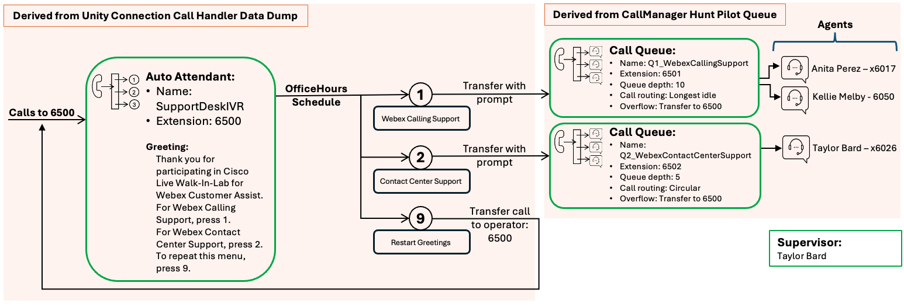
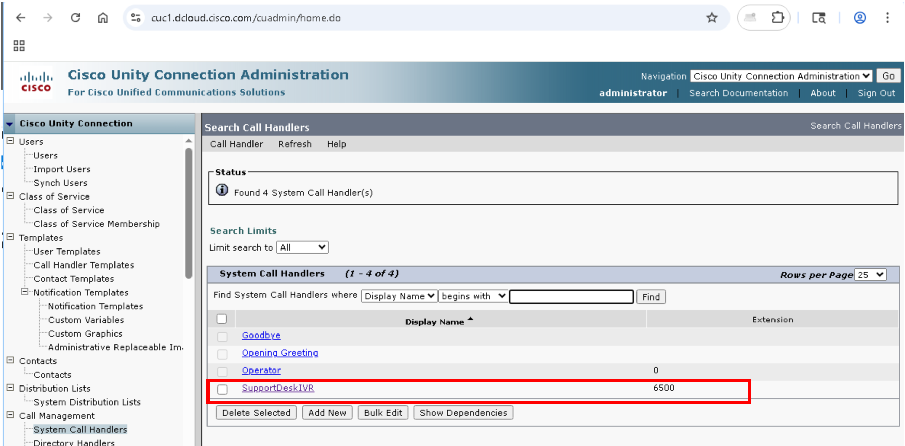
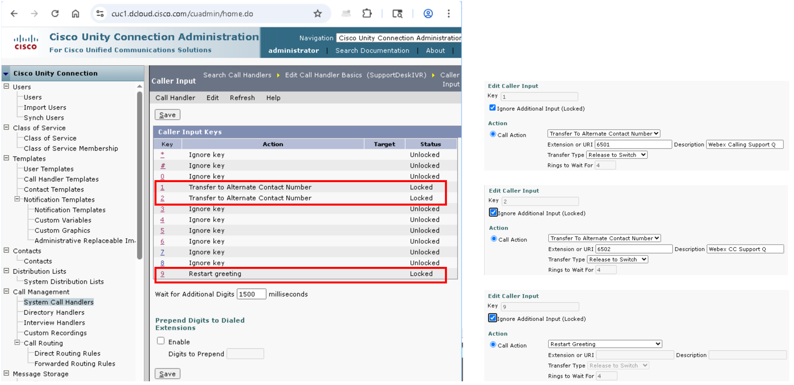
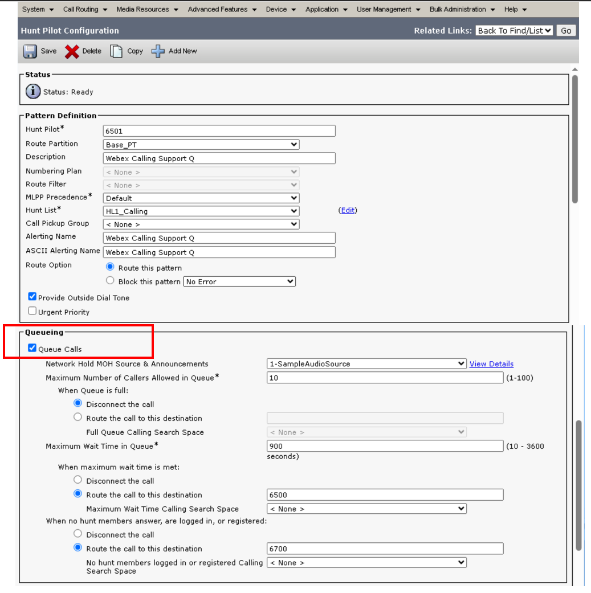
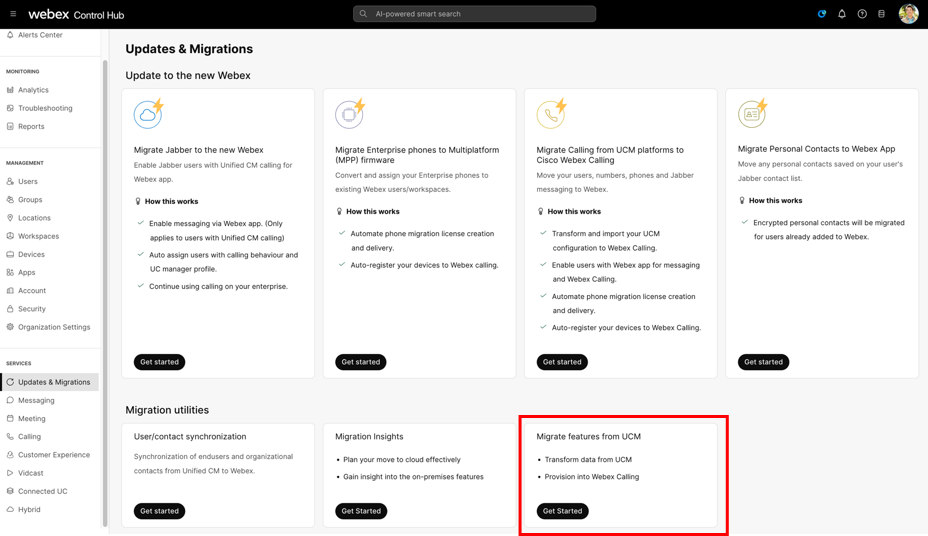
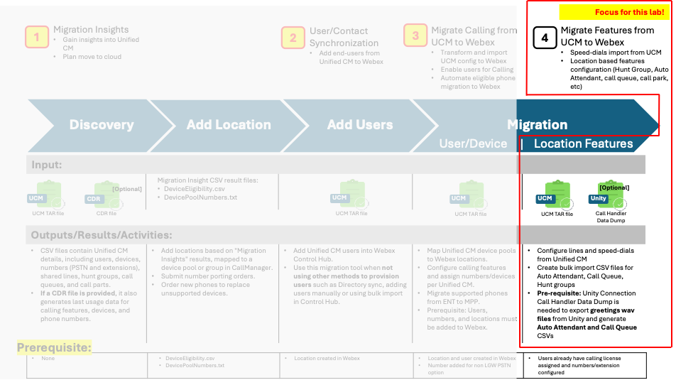

# Overview {#overview}

This lab offers step-by-step guidance for migrating an on-premises
Auto Attendant (from Unity Connection's call handler configuration) and
call queues (from Unified Communications Manager's Hunt Pilot queueing
configuration). It includes assigning Webex Calling Customer Assist
licenses to users designated as agents and supervisors. Additionally,
you will learn how to configure advanced features such as Screen Pop and
explore the Agent and Supervisor desktops. As part of the Customer
Assist feature set, you'll also gain hands-on experience with queue
analytics.

In this overview, we will examine a sample helpdesk call flow
configured in CUCM and Unity Connection to be migrated to Webex Calling
Customer Assist. The Walk-In Labs hands-on session begins with <a href="03-task-1-accessing-your-lab.html#task-1-accessing-your-lab"><strong>Task 1: Accessing your Lab [5
minutes]</strong></a>.

## Complete Call Flow {#complete-call-flow}

Below is the complete call flow for Call Handler and Hunt Pilot
Queues that will be migrated to Webex Calling as Customer Assist
configuration:

<figure class="lab-figure"></figure>

List of agents and supervisor:

<table>

<thead>
<tr>
<th>User</th>
<th>User Extension</th>
<th>Queue</th>
<th>Queue Extension</th>
<th>Role</th>
</tr>
</thead>
<tbody>
<tr>
<td>Charles Holland</td>
<td>6018</td>
<td>&lt;none&gt;</td>
<td>&lt;none&gt;</td>
<td>Call-in user</td>
</tr>
<tr>
<td>Anita Perez</td>
<td>6017</td>
<td>Q1_WebexCallingSupport</td>
<td>6501</td>
<td>Agent</td>
</tr>
<tr>
<td>Kellie Melby</td>
<td>6050</td>
<td>Q1_WebexCallingSupport</td>
<td>6501</td>
<td>Agent</td>
</tr>
<tr>
<td>Taylor Bard</td>
<td>6026</td>
<td>Q1_WebexCallingSupport 
Q2_WebexContactCenterSupport</td>
<td>6501 
6502</td>
<td>Supervisor</td>
</tr>
</tbody>
</table>

Additional Customer Assist features that can be configured after
migrating the configuration over to Webex Calling:

<ul>
<li>
Screen Pop
</li>
<li>
Call back
</li>
<li>
Night Service
</li>
<li>
Bounced Calls
</li>
</ul>

<ul>
<li>
Wrap-up reasons
</li>
<li>
Stranded Calls
</li>
<li>
Estimated Wait Time announcement
</li>
<li>
Queue position announcement
</li>
</ul>

## Call Handler Configuration in Unity Connection {#call-handler-configuration-in-unity-connection}

Below is overview of current call handler configuration in Unity
Connection &gt; Call Management &gt; System Call Handler – for this
lab.

<figure class="lab-figure"></figure>
<figure class="lab-figure"></figure>
## Hunt Pilot Queuing in Unified Communications Manager {#hunt-pilot-queuing-in-unified-communications-manager}

Below is one of the two call queues configuration in Unified
Communications Manager &gt; Call Routing &gt; Route/Hunt &gt; Hunt Pilot
– for this lab.

<figure class="lab-figure"></figure>
<aside class="lab-note" role="note">
<strong>Note:</strong>

<ul>
<li>
The "Queue Calls" box must be checked to indicate that this Hunt
Pilot in Unified Communications Manager is configured as a call
queue.
</li>
<li>
If the box is not checked, it will be considered as a Hunt Group
only.
</li>
</ul></aside>
## Migration Utilities in Control Hub {#migration-utilities-in-control-hub}

In this lab, you will be using “Migrate features from UCM” found in
Updates &amp; Migrations under the Services section on Control Hub.

<figure class="lab-figure"></figure>
<figure class="lab-figure"></figure>

<strong>#4 – Migrate features from UCM:</strong> Use this tool to
migrate speed dials, Call Park, virtual lines, Auto Attendant, Call
Queue, Hunt Groups, etc. We will use this tool to migrate Auto Attendant
and Call Queue for this lab.

