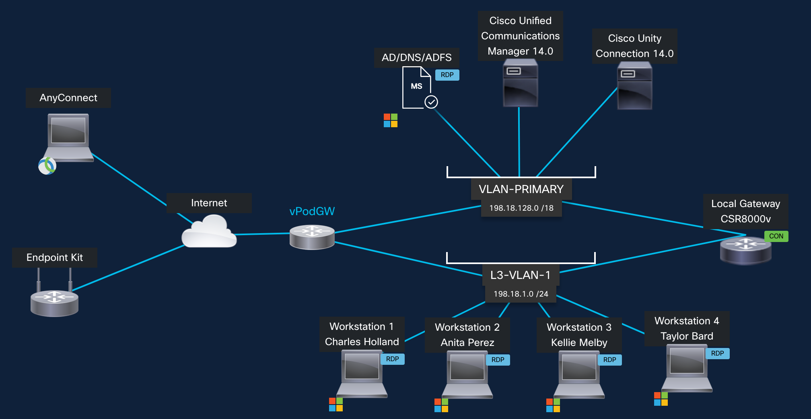

# Topology {#topology}

The lab will have Unified Communications Manager and Unity Connection
with preconfigured users and devices.

<figure class="lab-figure"></figure>

<table>

<thead>
<tr>
<th><strong>Application</strong></th>
<th><strong>Version</strong></th>
<th><strong>IP address or URL</strong></th>
<th><strong>Username</strong></th>
<th><strong>Password</strong></th>
</tr>
</thead>
<tbody>
<tr>
<td>Cisco Unified Communications Manager</td>
<td>14.x</td>
<td>198.18.133.3</td>
<td>administrator</td>
<td>dCloud123!</td>
</tr>
<tr>
<td>Unity Connection</td>
<td>14.x</td>
<td>198.18.133.5</td>
<td>administrator</td>
<td>dCloud123!</td>
</tr>
<tr>
<td>User Workstation 1</td>
<td>Windows 10</td>
<td>198.18.1.36</td>
<td>dcloud\cholland</td>
<td>dCloud123!</td>
</tr>
<tr>
<td>User Workstation 2</td>
<td>Windows 10</td>
<td>198.18.1.37</td>
<td>dcloud\aperez</td>
<td>dCloud123!</td>
</tr>
<tr>
<td>User Workstation 5</td>
<td>Windows 10</td>
<td>198.18.1.35</td>
<td>dcloud\kmelby</td>
<td>dCloud123!</td>
</tr>
<tr>
<td>User Workstation 6</td>
<td>Windows 10</td>
<td>198.18.1.40</td>
<td>dcloud\tbard</td>
<td>dCloud123!</td>
</tr>
<tr>
<td>Cisco CSR8000v</td>
<td>17.13.1a</td>
<td>198.18.1.227</td>
<td>admin</td>
<td>dCloud123!</td>
</tr>
<tr>
<td>Webex Calling Control Hub admin portal</td>
<td></td>
<td><a href="https://admin">https://admin</a>.webex.com</td>
<td>cholland@cb<mark>XXX</mark>.dc-<mark>YY</mark>.com</td>
<td>dCloud<mark>ZZZZ</mark>!</td>
</tr>
</tbody>
</table>

Users detail:

<table>

<thead>
<tr>
<th><strong>User</strong></th>
<th><strong>Mail ID</strong></th>
<th><strong>Directory Number</strong></th>
<th><strong>Calling enabled in Control Hub</strong></th>
</tr>
</thead>
<tbody>
<tr>
<td>Adam McKenzie</td>
<td>amckenzie@cb<mark>XXX</mark>.dc-<mark>YY</mark>.com</td>
<td>6016</td>
<td>N</td>
</tr>
<tr>
<td>Anita Perez</td>
<td>aperez@cb<mark>XXX</mark>.dc-<mark>YY</mark>.com</td>
<td>6017</td>
<td><strong>Y</strong></td>
</tr>
<tr>
<td>Charles Holland</td>
<td>cholland@cb<mark>XXX</mark>.dc-<mark>YY</mark>.com</td>
<td>6018</td>
<td><strong>Y</strong></td>
</tr>
<tr>
<td>Eric Steele</td>
<td>esteele@cb<mark>XXX</mark>.dc-<mark>YY</mark>.com</td>
<td>6099</td>
<td>N</td>
</tr>
<tr>
<td>Kellie Melby</td>
<td>kmelby@cb<mark>XXX</mark>.dc-<mark>YY</mark>.com</td>
<td>6050</td>
<td><strong>Y</strong></td>
</tr>
<tr>
<td>Monica Cheng</td>
<td>mcheng@cbXXX.dc-YY.com</td>
<td>6020</td>
<td>N</td>
</tr>
<tr>
<td>Rebekah Barretta</td>
<td>rbarretta@cb<mark>XXX</mark>.dc-<mark>YY</mark>.com</td>
<td>6088</td>
<td>N</td>
</tr>
<tr>
<td>Ricardo Filice</td>
<td>rfilice@cb<mark>XXX</mark>.dc-<mark>YY</mark>.com</td>
<td>6083</td>
<td>N</td>
</tr>
<tr>
<td>Stefan Mauk</td>
<td>smauk@cb<mark>XXX</mark>.dc-<mark>YY</mark>.com</td>
<td>6072</td>
<td>N</td>
</tr>
<tr>
<td>Taylor Bard</td>
<td>tbard@cb<mark>XXX</mark>.dc-<mark>YY</mark>.com</td>
<td>6026</td>
<td><strong>Y</strong></td>
</tr>
</tbody>
</table>

<aside class="lab-note" role="note">
<strong>Note:</strong>

Detail on how to find your lab domain name
(@cb<mark>XXX</mark>.dc-<mark>YY</mark>.com) and last 4-digits of your
lab session ID (<mark>ZZZZ</mark>) will be explained in Task 1:
Accessing your Lab, below.
</aside>
