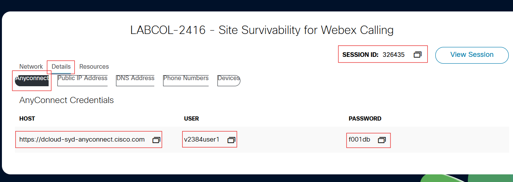
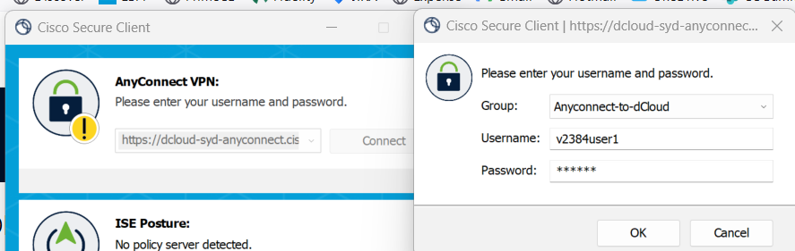
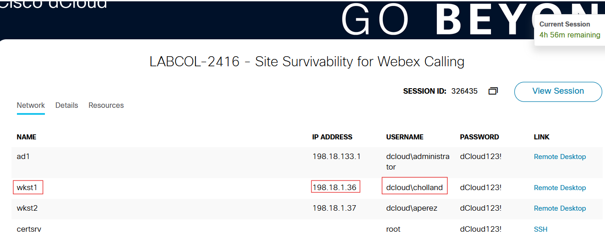
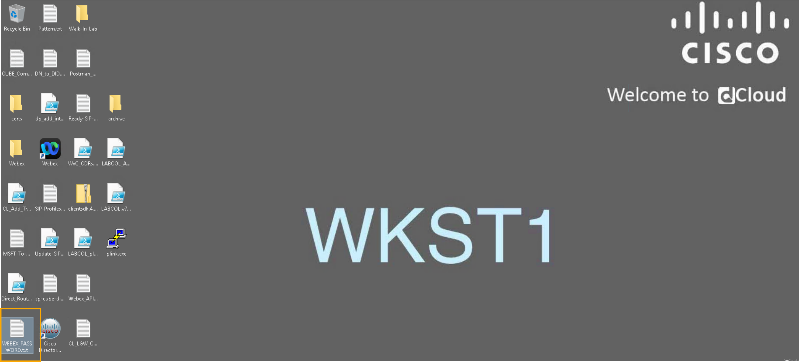
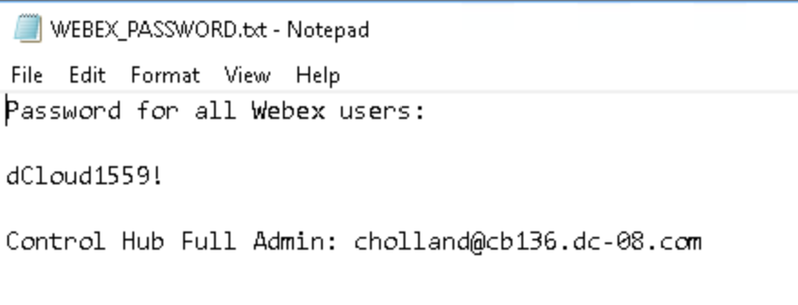
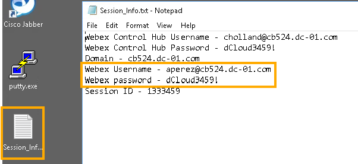

# Task 1: Accessing your Lab {#task-1-accessing-your-lab}

Click on the <strong>Details</strong> from the dCloud eXPO page and
use the Host, Username and Password to connect using Cisco Secure Client
(formerly AnyConnect) to your dedicated dCloud session.

Also note your session ID as displayed below. In the example below,
following are the details.

AnyConnect (Cisco Secure Client) Host: use the value provided privately for your assigned session.<a href="https://dcloud-syd-anyconnect.cisco.com">https://dcloud-syd-anyconnect.cisco.com</a>

AnyConnect (Cisco Secure Client) Username: use the value provided privately for your assigned session.
<strong>[assigned VPN username]</strong>

AnyConnect (Cisco Secure Client) Password: use the value provided privately for your assigned session.
<strong>[assigned VPN password]</strong>

<figure class="lab-figure"></figure>
<figure class="lab-figure"></figure>

<aside class="lab-note" role="note">
<strong>Important! Each dCloud session has its own unique details. Do
not use the credentials shown above in the screenshots.</strong>
</aside>

## Connect to the Workstations via Remote Desktop {#connect-to-the-workstations-via-remote-desktop}

Connect to the Remote desktop of Workstation 1. On your session
topology click workstation 1 and click Remote Desktop to connect

The user for Workstation 1 in this lab will be Charles Holland
(<strong>cholland</strong>), username and password will be provided in a
file on the Desktop of the workstation.

To connect to Workstation 2, follow similar instructions. The user
for Workstation 2 will be Anita Perez (<strong>aperez</strong>).

<figure class="lab-figure"></figure>
<figure class="lab-figure"></figure>

Within Workstation 1’s Desktop, there will be a file named
WEBEX_PASSWORD.txt or Session_Info.txt as shown above. Launch the file
to get the username and password for the Webex App and the Collaboration
Control Hub for this lab.

<figure class="lab-figure"></figure>

OR

<figure class="lab-figure"></figure>
## Login to the Webex Clients {#login-to-the-webex-clients}

Login to the Webex App from within workstation 1 for the user Charles
Holland (cholland) and from within workstation 2 for the user Anita
Perez (aperez). Credentials should be in the respective files placed on
the Desktops of the respective workstations. Refer to an example file
with the credential details:

<figure class="lab-figure"></figure>
## Login to Collaboration Control Hub from within Workstation 1 {#login-to-collaboration-control-hub-from-within-workstation-1}

Lauch the Chrome browser from within workstation 1and go to <a href="https://admin.webex.com/">https://admin.webex.com</a>. Login using
the credentials from the WEBEX_PASSWORD.txt file from the previous
section. If WEBEX_PASSWORD.txt is not present, check Session_Info.txt on the
Desktop. If neither file is available, ask the lab instructor for your session credentials.
Continue with <a href="task-2.html">Task 2</a>. Complete the configuration tasks
from Workstation 1; Task 10 specifies the devices and accounts to use for validation

<strong>Now you can proceed with the lab modules.</strong>

