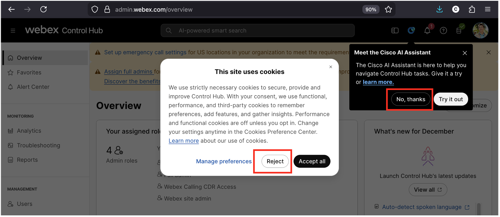
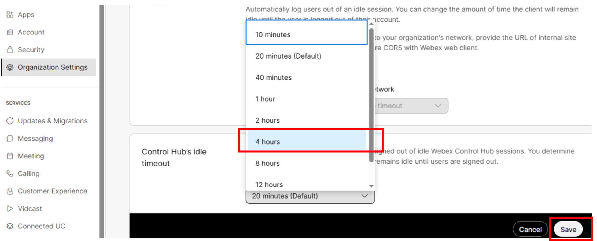
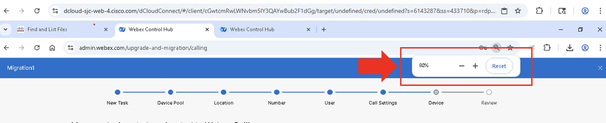

# Task 4: Access Control Hub [2 minutes] {#task-4-access-control-hub-2-minutes}

### Step 1: Login to Control Hub {#step-1-login-to-control-hub}

<ol type="1">
<li>
Launch Chrome browser from Workstation 1
</li>
<li>
Click on “Cisco Webex Links” &gt; note the username and password
shown under “Cisco Webex Control Hub” – or you can refer to your note
from Task 1 – Accessing your Lab.
</li>
</ol>

[Screenshot with example access credentials omitted. Use your assigned lab session details.]

<ol start="3" type="1">
<li>
Click on “Cisco Webex Control Hub”
</li>
<li>
Login using the email address and password as explained in Task 1
- <a href="03-task-1-accessing-your-lab.html">Step 3: Login Credential for Control Hub and
Webex app</a>.
</li>
<li>
You can select “Reject” for <em><mark>This site uses
cookies</mark></em> pop-up window prompt – no impact to functionality.
And select “No, thanks” at <em><mark>Meet the Cisco AI
Assistant</mark></em> prompt to skip AI Assistant tour.
</li>
</ol>

### Step 2: Change Control Hub idle timeout {#step-2-change-control-hub-idle-timeout}

<ol type="1">
<li>
Under Management, click on “Organization Settings”
</li>
<li>
Scroll down until you can see “Control Hub’s idle
timeout”
</li>
<li>
Change the value from 20 minutes (Default) to “4 hours”
</li>
</ol>

<ol start="4" type="1">
<li>
Click “Save”
</li>
</ol>

### Step 3: Change Your PC or Laptop Display Resolution {#step-3-change-your-pc-or-laptop-display-resolution}

If your <strong>monitor's</strong> limited resolution is at or
smaller than 1440x900, you will need to zoom out to 80% (Ctrl + “-“) to
better view the screen content for the rest of this lab.

