# Migrate Auto Attendant and Call Queue {#task-5-migrate-auto-attendant-and-call-queue-10-minutes}

LABCOL-2883 Task 510 minutes

In this phase we will complete the following tasks:

<ol type="a">
<li>
Utilize the Migration Utility to convert CUCM and CUC files into
Auto Attendant and Call Queue CSV files, enabling bulk import into
Control Hub
</li>
<li>
Assign Webex Calling Customer Assist license to users that will
be agents and Supervisor
</li>
<li>
Create office hours schedule and upload greeting audio
files
</li>
</ol>
<aside class="lab-note" role="note">
<strong>Note:</strong>

At the start of the lab, Charles Holland, Anita Perez, Kellie Melby,
Taylor Bard are already assigned Webex Calling license and configured
with extension numbers.

<figure class="lab-figure"><a aria-label="Enlarge Lab guide screenshot 30" class="screenshot-link" href="assets/images/image30.png">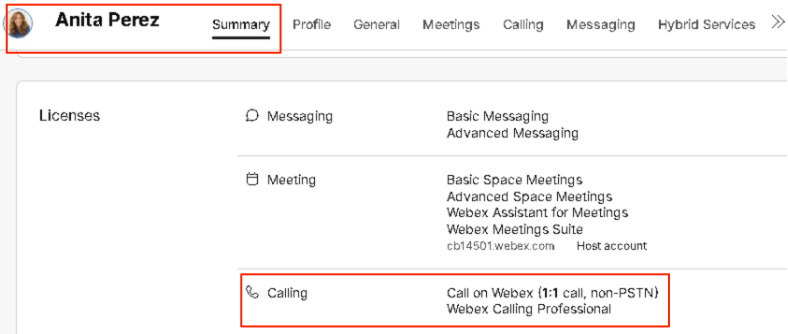</a></figure>
</aside>
## Step 1: Starting Migrate Features from UCM Tool {#step-1-starting-migrate-features-from-ucm-tool}

Lets get started with the CUCM and CUC data import into the Control
Hub.

From Control Hub portal, under Services, click on “Updates and
Migrations”, then click on “Get Started” for Migrate Feature from
UCM

<figure class="lab-figure"><a aria-label="Enlarge Lab guide screenshot 31" class="screenshot-link" href="assets/images/image31.png">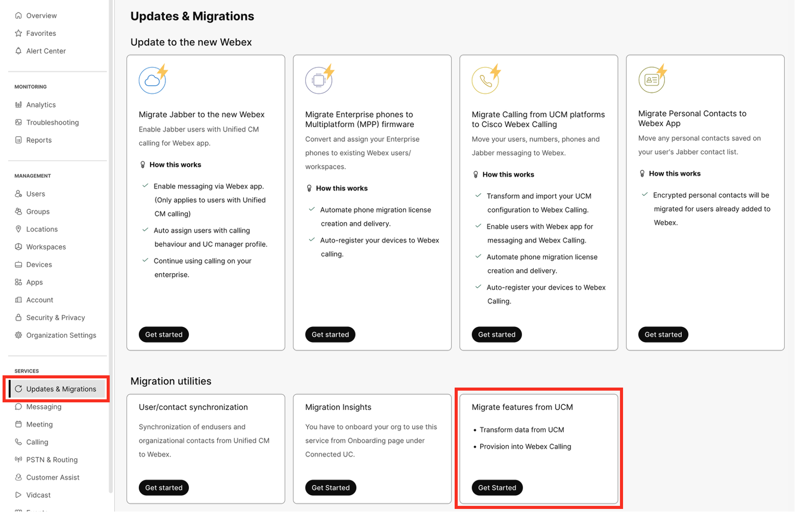</a></figure>

After clicking Get Started, select the UCM tar that you have saved
under folder “Walk-In-Lab-&gt; LABCOL &gt; CUCM” and upload by click on
“Choose a file” or drag and drop to the tool.

<figure class="lab-figure"><a aria-label="Enlarge Lab guide screenshot 32" class="screenshot-link" href="assets/images/image32.png">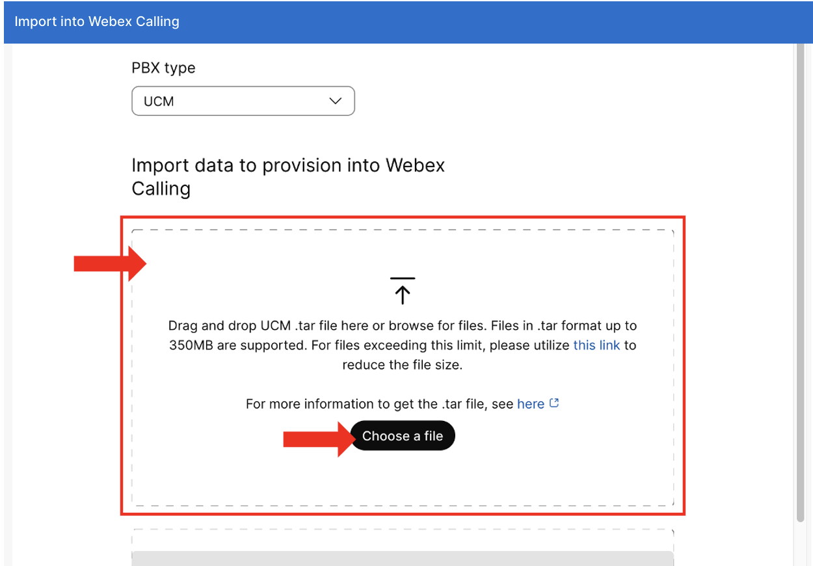</a></figure>

Next is to upload Unity Call Handler Data Dump zip file. Select
“Unity Connection Call Hanlder Data Dump.zip” file from “Walk-In-Lab
&gt; LABCOL &gt; Unity Connection &gt; Call Handler Data Dump &gt; CSV”
folder and upload by drag-and-drop or by click on “Choose a file”.

<aside class="lab-note" role="note">
<strong><mark>Note: you might have to scroll down to see Unity upload
box, depending on your screen size.</mark> Suggested to zoom out to 80%
(Ctrl + “-“) for better view of the screen content.</strong>
</aside>
<figure class="lab-figure"><a aria-label="Enlarge Lab guide screenshot 33" class="screenshot-link" href="assets/images/image33.png">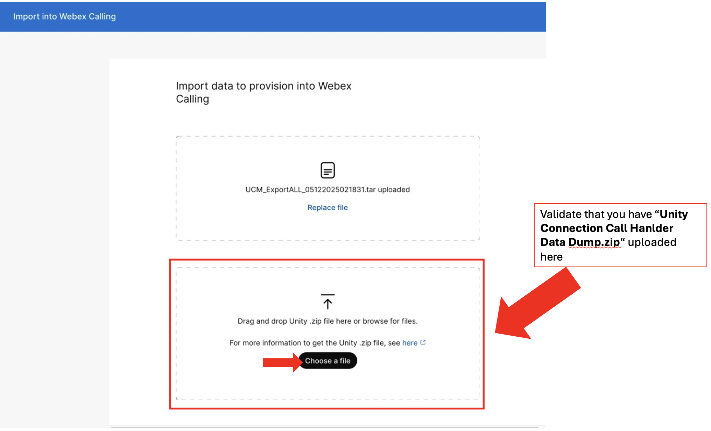</a></figure>

After both files are uploaded, click the “Next” button on the bottom
left corner of the screen.

<figure class="lab-figure"><a aria-label="Enlarge Lab guide screenshot 34" class="screenshot-link" href="assets/images/image34.png">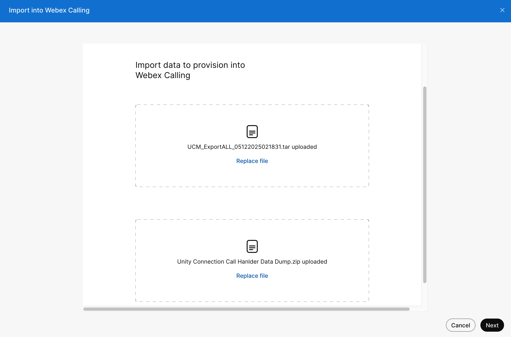</a></figure>

The processing and transformation process of this tool can take up to
8-10 minutes.

<figure class="lab-figure"><a aria-label="Enlarge Lab guide screenshot 35" class="screenshot-link" href="assets/images/image35.png">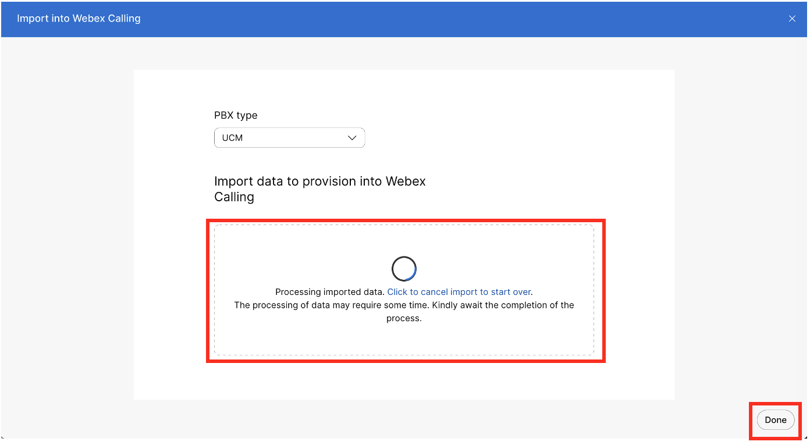</a></figure>

While waiting for the process to finish we can work on a few prep
activities to get ready for the next phase. You can click “Done” toward
the bottom of the window; this will not abort the process. It will
continue the staging in the background.

## Step 2: Upload Greeting Audio File for Auto Attendant {#step-2-upload-greeting-audio-file-for-auto-attendant}

For this lab we will be uploading Greeting file exported from Unity
Connection using Call Handler Data Dump tool. This greeting audio file
will be used for Auto Attendant that will be created later in this
lab.

From Control Hub portal, under Services, click on “Calling”, then
select the “Features” tab. In the announcements tile card, click on “Add
New”.

<figure class="lab-figure"><a aria-label="Enlarge Lab guide screenshot 36" class="screenshot-link" href="assets/images/image36.png">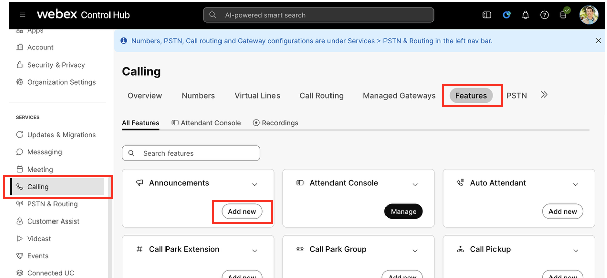</a></figure>

Fill the rest of fields as shown below:

<ul>
<li>
Level = “Organization”
</li>
<li>
Label = “SupportDeskIVR”
</li>
<li>
Use greeting file as noted below.
</li>
<li>
Click “Save” to continue
</li>
</ul>

<a aria-label="Enlarge Lab guide screenshot 37" class="screenshot-link" href="assets/images/image37.png">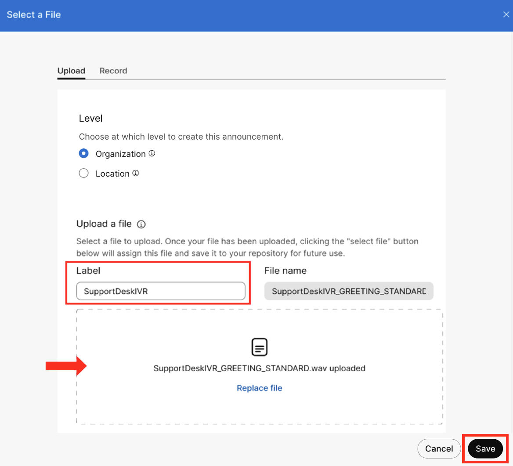</a>

Click “Select File” or drag-and-drop to upload the greeting audio
file from “Walk-In-Lab-&gt;LABCOL-&gt;Unity Connection-&gt;Call Handler
Data Dump-&gt;CSV” folder.

The file to use is
“<strong>SupportDeskIVR_GREETING_STANDARD.WAV</strong>".

<figure class="lab-figure"><a aria-label="Enlarge Lab guide screenshot 38" class="screenshot-link" href="assets/images/image38.png">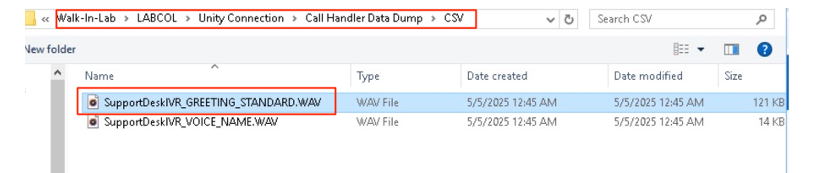</a></figure>

After successful upload, the new greeting file will be listed under
Announcement section as shown below.

<figure class="lab-figure"><a aria-label="Enlarge Lab guide screenshot 39" class="screenshot-link" href="assets/images/image39.png">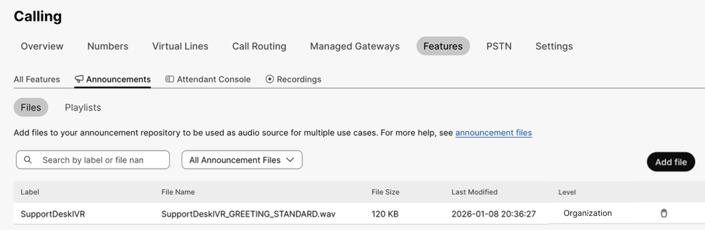</a></figure>
<aside class="lab-note" role="note">
<strong>Note:</strong>

Test-to-Speech (TTS) for announcement is coming in March 2026, this
feature will enable efficient and quick prompts, greetings, and
announcements generation from text. It functions like a recorded WAV
file eliminating the need for manual recording.
</aside>
## Step 3: Validate Location PSTN Type and Main number {#step-3-validate-location-pstn-type-and-main-number}

At this step, you will be verifying PSTN type for dCloud
location.

<ol type="1">
<li>
Under Management, click on “Locations”
</li>
<li>
Click on “dCloud” &gt; navigate and click on “PSTN” tab
</li>
<li>
Verify that PSTN Connection = Premised-based PSTN, and a number
is assigned to the Main number field.
</li>
</ol>
<figure class="lab-figure"><a aria-label="Enlarge Lab guide screenshot 40" class="screenshot-link" href="assets/images/image40.png">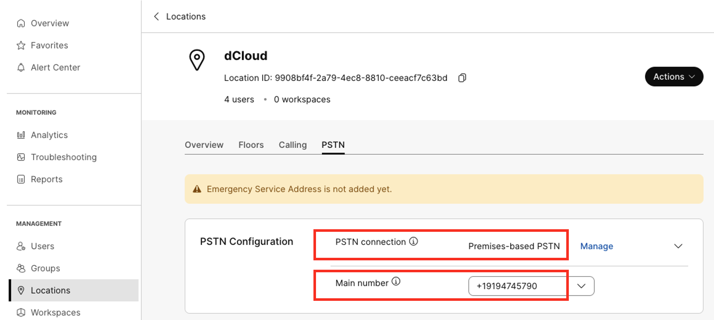</a></figure>
<aside class="lab-note" role="note">
<strong>Note:</strong>

<ul>
<li>
If there is a caution symbol next to a location, it indicates
that <strong>no</strong> telephone number has been configured. Any type
of calls cannot be made or received until a number is set up.
</li>
</ul>
<figure class="lab-figure"><a aria-label="Enlarge Lab guide screenshot 41" class="screenshot-link" href="assets/images/image41.png">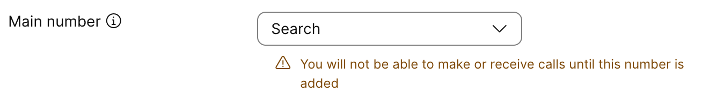</a></figure>
<ul>
<li>
You can try to fix this yourself with a PowerShell script from
Workstation 1 desktop to re-add the main number and PSTN phone numbers.
In the desktop view, find <strong>LABCOL.v7.ps1</strong> file,
right-click on it and select “<strong>Run with
PowerShell</strong>”.
</li>
</ul>
<figure class="lab-figure"><a aria-label="Enlarge Lab guide screenshot 42" class="screenshot-link" href="assets/images/image42.png">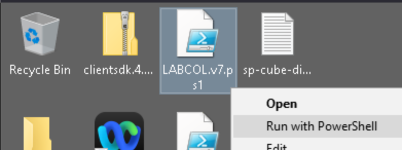</a></figure>
<ul>
<li>
Verify that your lab is on RTP or SJC Data Center if <strong>Main
number</strong> field still has no value after you ran the PowerShell
script above. You can schedule another lab just in case the lab
automation has not run properly.
</li>
</ul></aside>
## Step 4: Create Office Hours Schedule {#step-4-create-office-hours-schedule}

Scheduling supports various calling features, such as auto
attendants, by defining time slots during which specific behaviors are
executed.

At least one schedule for Business Hours needs to be created for this
lab.

From Control Hub portal, under Management, click on “Locations”, then
select the location where the schedule will be created.

<figure class="lab-figure"><a aria-label="Enlarge Lab guide screenshot 43" class="screenshot-link" href="assets/images/image43.png">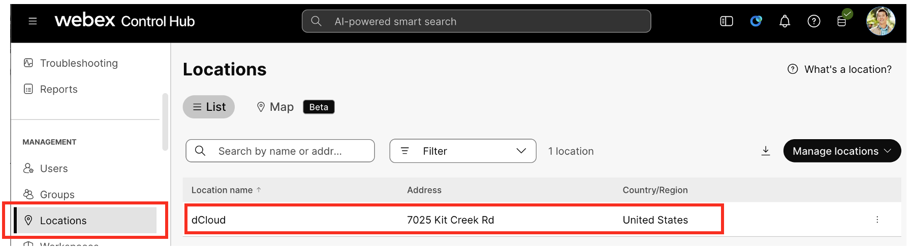</a></figure>

Click on “Calling” tab &gt; Scroll to “Calling features setting” &gt;
click “Schedules”.

<figure class="lab-figure"><a aria-label="Enlarge Lab guide screenshot 44" class="screenshot-link" href="assets/images/image44.png">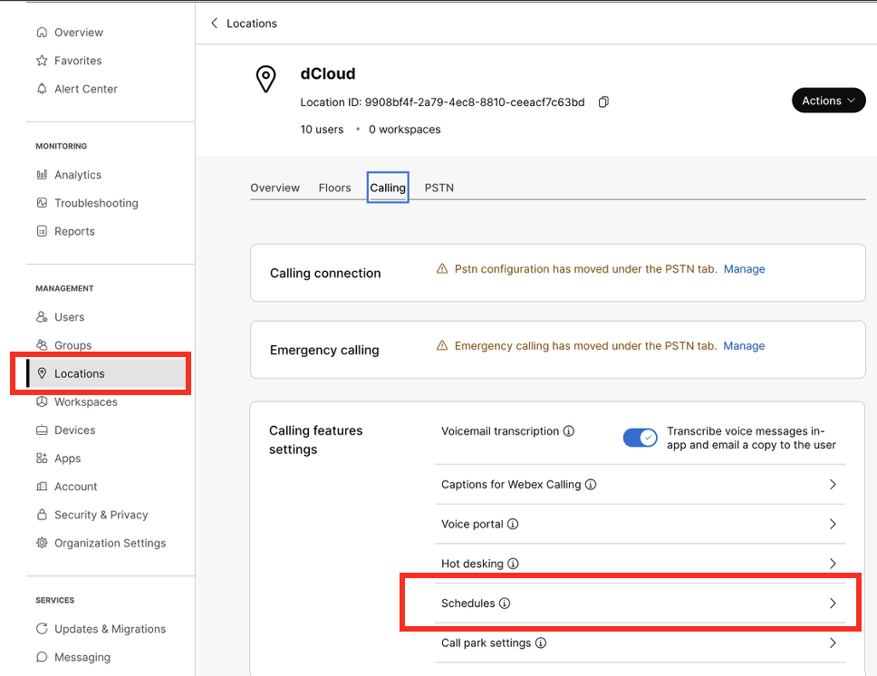</a></figure>

Click on “Add schedule”

<figure class="lab-figure"><a aria-label="Enlarge Lab guide screenshot 45" class="screenshot-link" href="assets/images/image45.png">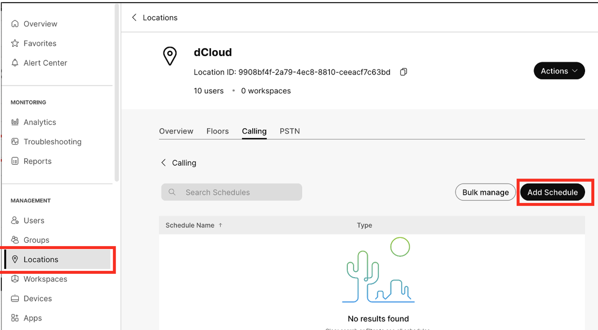</a></figure>

For the schedule name enter “<strong>OfficeHours</strong>”,
Schedule type “Business Hours”

<ul>
<li>
Update the hours of operation to “12:00 AM to 5:00 PM” for Monday
through Friday to accommodate the time difference between Amsterdam and
the US, where this lab is hosted.
</li>
<li>
Uncheck: Sunday, Saturday and Lunch
</li>
<li>
Click on “<strong>Save</strong>” when done with the schedule
entry
</li>
</ul>

<a aria-label="Enlarge Lab guide screenshot 46" class="screenshot-link" href="assets/images/image46.png">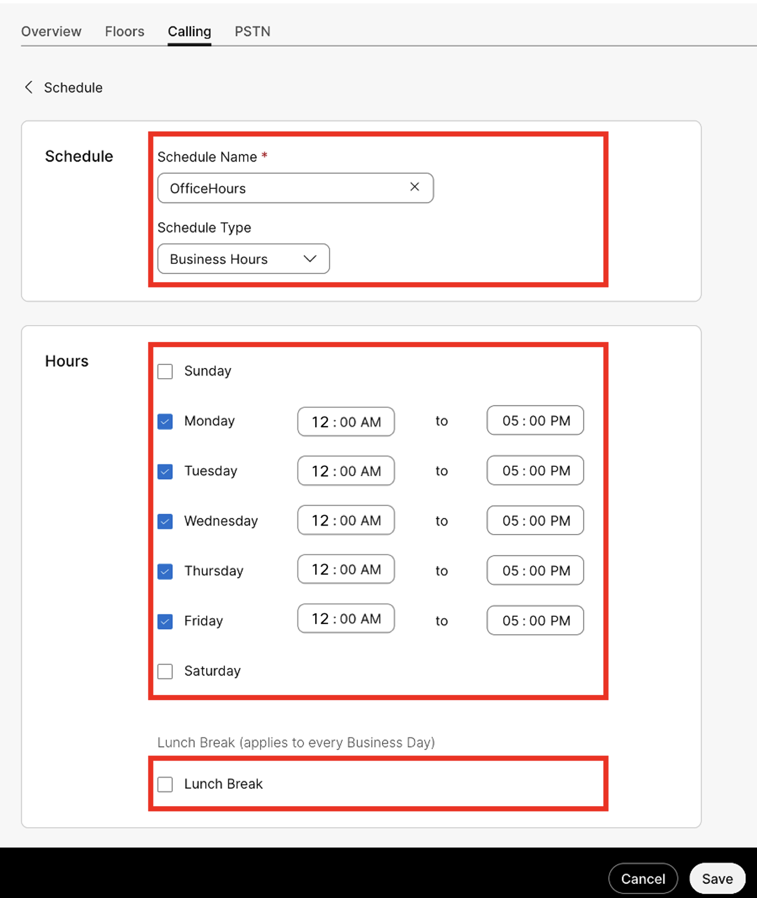</a>

Next screen will show that “OfficeHours” schedule has been added.

<figure class="lab-figure"><a aria-label="Enlarge Lab guide screenshot 47" class="screenshot-link" href="assets/images/image47.png">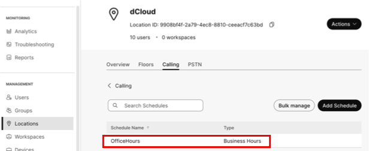</a></figure>
## Step 5: Validate Customer Assist License Availability {#step-5-validate-customer-assist-license-availability}

In this section, you will be verifying license availability for Webex
Calling Customer Assist. Under Management, click on “Account” &gt; click
on “Subscriptions” tab. In the License Summary section, verify Customer
Assist license availability.

<figure class="lab-figure"><a aria-label="Enlarge Lab guide screenshot 48" class="screenshot-link" href="assets/images/image48.png">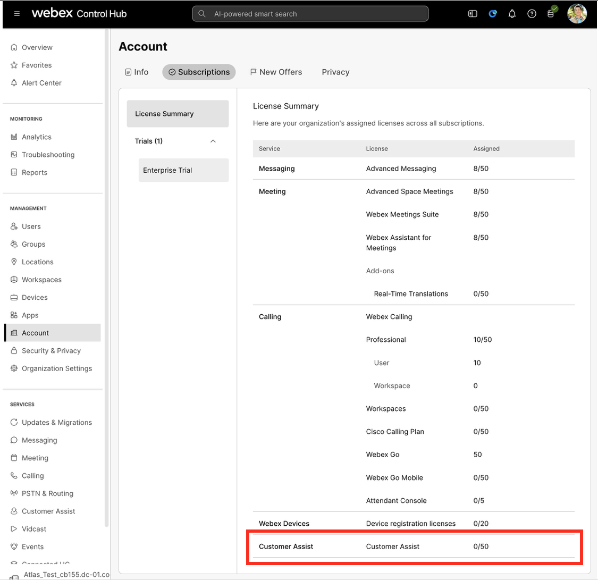</a></figure>
<aside class="lab-note" role="note">
<strong>Note:</strong>

License assignment is listed in xx/yy format.

<ul>
<li>
xx = license assigned to users or workstation
</li>
<li>
yy = total available license per your order
</li>
</ul></aside>
## Step 6: Assign Customer Assist License to agents and supervisor {#step-6-assign-customer-assist-license-to-agents-and-supervisor}

Each agent and supervisor will need to be assigned a Customer Assist
license. In this lab we will add this license to the following users:
Anita Perez, Kellie Melby and Taylor Bard.

From Control Hub portal, under Management, click on “User”, then
select the user that need to be assigned Customer Assist license.

<figure class="lab-figure"><a aria-label="Enlarge Lab guide screenshot 49" class="screenshot-link" href="assets/images/image49.png">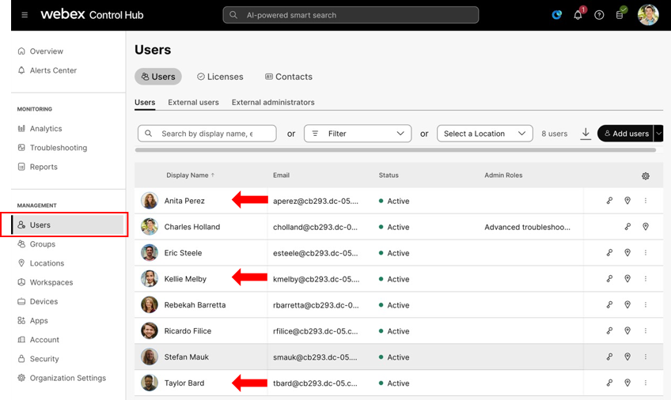</a></figure>

Let’s start with Anita Perez by clicking on that user. In the
“Summary” tab, scroll down and search for “Licenses” section. This user
currently has Calling license assigned.

Click on the “<strong>Edit Licenses</strong>” icon to start adding
“Customer Assist” license:

<figure class="lab-figure"><a aria-label="Enlarge Lab guide screenshot 50" class="screenshot-link" href="assets/images/image50.png">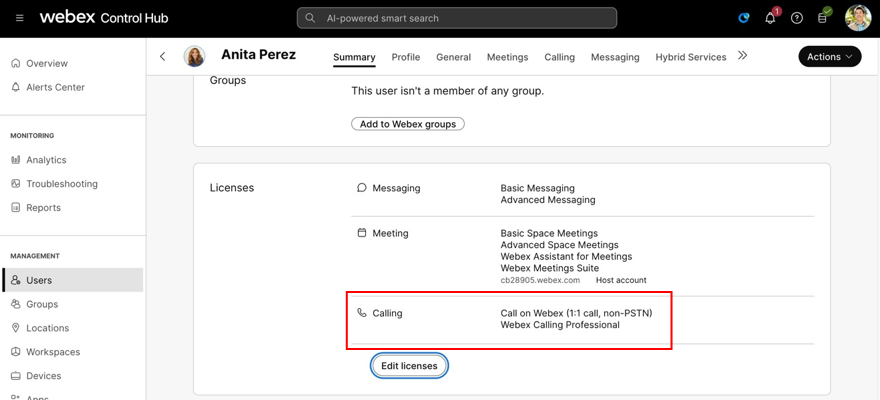</a></figure>

Click one more time on the “<strong>Edit Licenses</strong>” icon in
the next license summary screen:

<figure class="lab-figure"><a aria-label="Enlarge Lab guide screenshot 51" class="screenshot-link" href="assets/images/image51.png">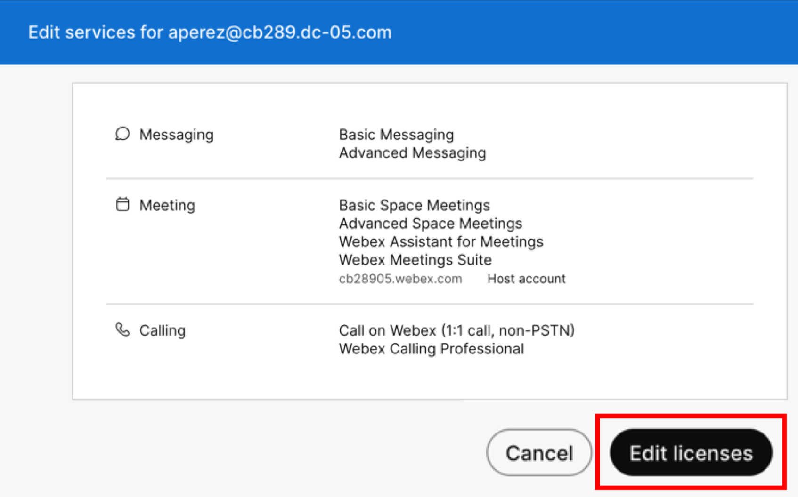</a></figure>

Click Customer Assist from the left-side menu.
<strong>Checked</strong> the Customer Assist checkbox and click
Save.

<figure class="lab-figure"><a aria-label="Enlarge Lab guide screenshot 52" class="screenshot-link" href="assets/images/image52.png">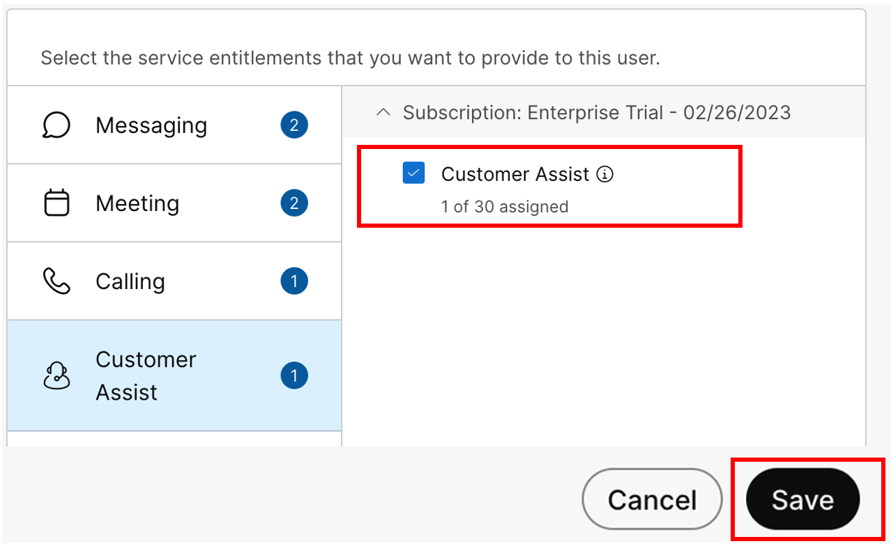</a></figure>

Once the License assignment is successful, you can click Close in the
bottom of the window.

<figure class="lab-figure"><a aria-label="Enlarge Lab guide screenshot 53" class="screenshot-link" href="assets/images/image53.png">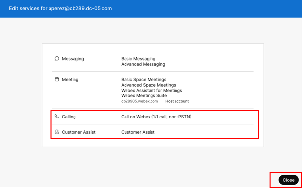</a></figure>
<aside class="lab-note" role="note">
<strong>Note:</strong>

Once the Customer Assist license is assigned, you may notice that the
Webex Calling Professional license is unassigned. Webex Calling is
already included as part of the Customer Assist license.
</aside>

<strong>Repeat</strong> the above steps for the following users:

- Kellie Melby

- Taylor Bard

## Step 7: Download CSV Result Files from Migrate Features from UCM Tool {#step-7-download-csv-result-files-from-migrate-features-from-ucm-tool}

Go back to the Migration utilities under Control Hub &gt; Services
&gt; Updates &amp; Migrations &gt; <strong>Migrate features from UCM
utility</strong>, by now the staging process should have been
finished.

Click <strong>Get Started</strong> on the “Migrate features from
UCM”

<figure class="lab-figure"><a aria-label="Enlarge Lab guide screenshot 54" class="screenshot-link" href="assets/images/image54.png">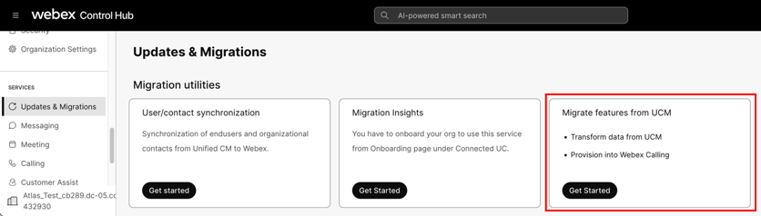</a></figure>

In the next screen, you would see message indicating Unified
Communications Manager tar file has been uploaded successfully.

Click on “Actions” and then “Export CSV”

<figure class="lab-figure"><a aria-label="Enlarge Lab guide screenshot 55" class="screenshot-link" href="assets/images/image55.png">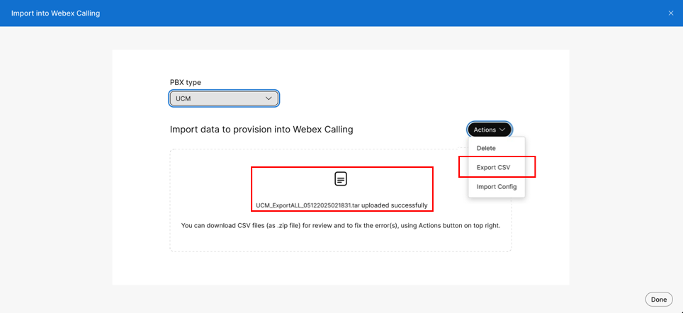</a></figure>

Select a folder to download the CSV. You can put it in the LABCOL
&gt; CUCM folder.

<figure class="lab-figure"><a aria-label="Enlarge Lab guide screenshot 56" class="screenshot-link" href="assets/images/image56.png">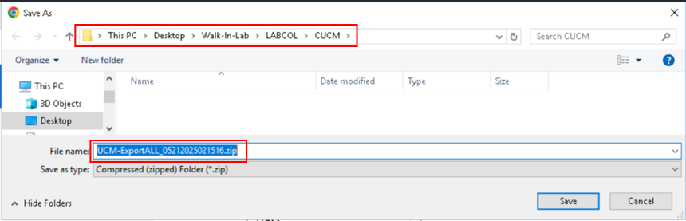</a></figure>

Click “Done” after the file download is completed.

<figure class="lab-figure"><a aria-label="Enlarge Lab guide screenshot 57" class="screenshot-link" href="assets/images/image57.png">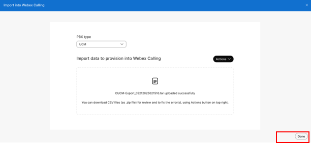</a></figure>

Right-click on the downloaded file inside folder “Walk-In-Lab &gt;
LABCOL &gt; CUCM”, select “Extract All”

<figure class="lab-figure"><a aria-label="Enlarge Lab guide screenshot 58" class="screenshot-link" href="assets/images/image58.png">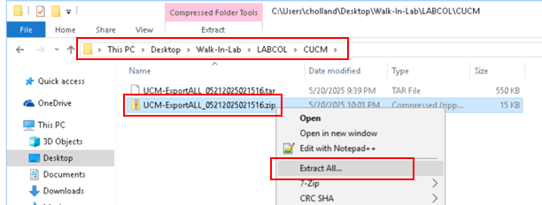</a></figure>

Accept the default folder to extract the file and the click
“Extract”. Note the folder location for later.

<figure class="lab-figure"><a aria-label="Enlarge Lab guide screenshot 59" class="screenshot-link" href="assets/images/image59.png">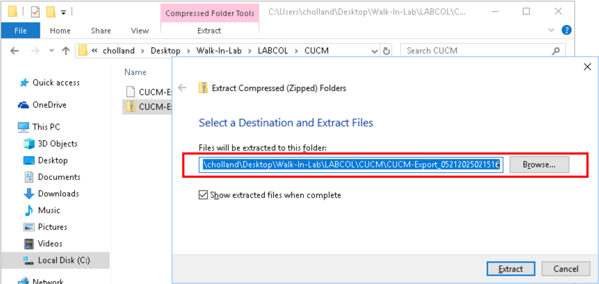</a></figure>

We will use the following two csv files for this lab:

<ul>
<li>
<strong>AutoAttendantBulk.csv</strong>: bulk configure Auto
Attendant in Control Hub
</li>
<li>
<strong>CallQueueBulk.csv</strong>: bulk configure Call Queue in
Control Hub
</li>
</ul>
<figure class="lab-figure"><a aria-label="Enlarge Lab guide screenshot 60" class="screenshot-link" href="assets/images/image60.png">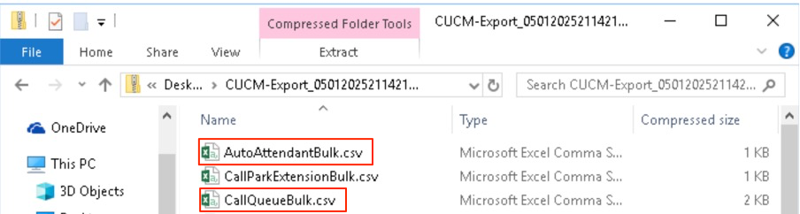</a></figure>
