# Task 6: Bulk import Auto Attendant [5 minutes] {#task-6-bulk-import-auto-attendant-5-minutes}

In this lab, some edits need to be done on the bulk csv result to map
to the correct Webex Calling configuration.

Open the “<strong>AutoAttendantBulk.csv</strong>” file in MS
Excel.

Follow the table below to update the values of specific cells in the
csv file – <strong>values are case sensitive</strong>.

<table style="width:98%;">
<colgroup>
<col style="width: 9%"/>
<col style="width: 37%"/>
<col style="width: 19%"/>
<col style="width: 33%"/>
</colgroup>
<thead>
<tr>
<th style="text-align: left;">Excel Cell #</th>
<th>Header Name</th>
<th style="text-align: left;">Original Value</th>
<th style="text-align: left;">Replacement Value</th>
</tr>
</thead>
<tbody>
<tr>
<td style="text-align: left;">B2</td>
<td>Phone Number</td>
<td style="text-align: left;">6500</td>
<td style="text-align: left;">&lt;blank&gt; (delete 6500)</td>
</tr>
<tr>
<td style="text-align: left;">C2</td>
<td>Extension</td>
<td style="text-align: left;">&lt;blank&gt;</td>
<td style="text-align: left;">6500</td>
</tr>
<tr>
<td style="text-align: left;">D2</td>
<td>Location</td>
<td style="text-align: left;">Error….</td>
<td style="text-align: left;">dCloud</td>
</tr>
<tr>
<td style="text-align: left;">F2</td>
<td>Language Code</td>
<td style="text-align: left;">Error….</td>
<td style="text-align: left;">en_us</td>
</tr>
<tr>
<td style="text-align: left;">J2</td>
<td>Business Schedule</td>
<td style="text-align: left;">All Hours Error..</td>
<td style="text-align: left;">OfficeHours</td>
</tr>
<tr>
<td style="text-align: left;">Q2</td>
<td>Business Hours Greeting Type</td>
<td style="text-align: left;">&lt;blank&gt;</td>
<td style="text-align: left;">CUSTOM</td>
</tr>
<tr>
<td style="text-align: left;">R2</td>
<td>Business Hours Announcement Name</td>
<td style="text-align: left;">
SupportDeskIVR_GREETING_STANDARD.WAV

Error: The greetings file cannot be found in WxC
</td>
<td style="text-align: left;">SupportDeskIVR_GREETING_STANDARD.WAV</td>
</tr>
<tr>
<td style="text-align: left;">S2</td>
<td>Business Hours Announcement Media Type</td>
<td style="text-align: left;">&lt;blank&gt;</td>
<td style="text-align: left;">WAV</td>
</tr>
<tr>
<td style="text-align: left;">T2</td>
<td>Business Hours Announcement Level</td>
<td style="text-align: left;">&lt;blank&gt;</td>
<td style="text-align: left;">ORGANIZATION</td>
</tr>
<tr>
<td style="text-align: left;">AZ2</td>
<td>Business Hours Press 9 Description</td>
<td style="text-align: left;">&lt;blank&gt;</td>
<td style="text-align: left;">Restart Greeting</td>
</tr>
</tbody>
</table>

<table style="width:100%;">
<colgroup>
<col style="width: 10%"/>
<col style="width: 89%"/>
</colgroup>
<thead>
<tr>
<th></th>
<th style="text-align: left;">
<strong>Note:</strong>

<ul>
<li>
Since this is a small lab without a complete dial-plan
configuration (e.g., no PSTN numbers, no inter-site dial prefixes, and
no preloaded greeting audio files), the Migrate Feature from the UCM
tool is unable to map to the correct Webex Calling location or recognize
the location name, language, or greeting file. As a result, the
adjustments outlined above are necessary.
</li>
<li>
If announcement greeting files are uploaded at the organization
level <strong>before</strong> running the "Migrate Features from UCM
Tool" then the AutoAttendantBulk.csv will automatically map fields Q2,
R2, S2, and T2 to the correct values and do not need manual update as
outlined above — provided the same WAV files are used.
</li>
</ul></th>
</tr>
</thead>
<tbody>
</tbody>
</table>

Once all fields are updated, <strong>close</strong> the file to save
and click “Yes” for any dialog prompts.

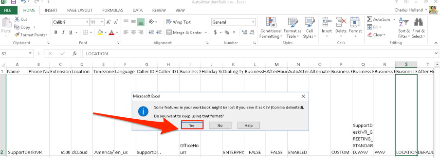

Go to Control Hub, click Calling -&gt; Features -&gt; Auto Attendant
-&gt; “Add New”

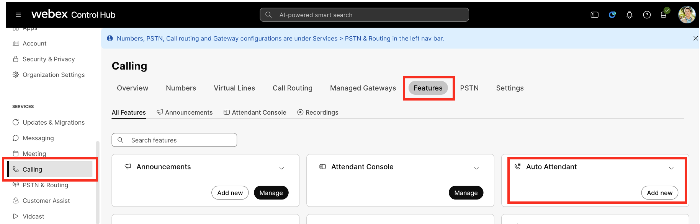

Click “Open the bulk editor” in Create Auto Attendant section.

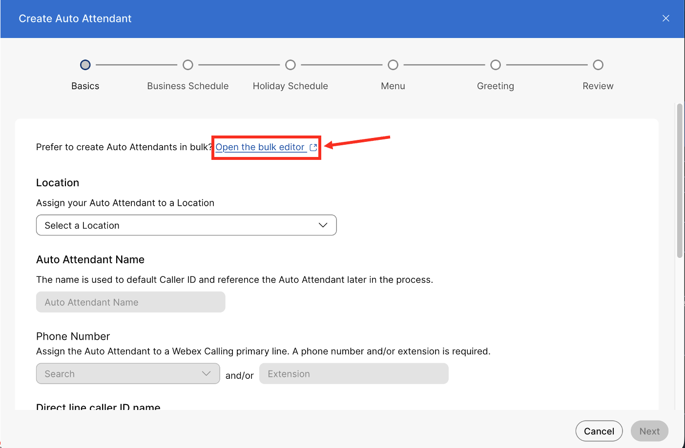

Upload the file that we just edited
“<strong>AutoAttendantBulk.csv</strong>” by drag-and-drop or click on
“Choose a file” and then click “Upload”.

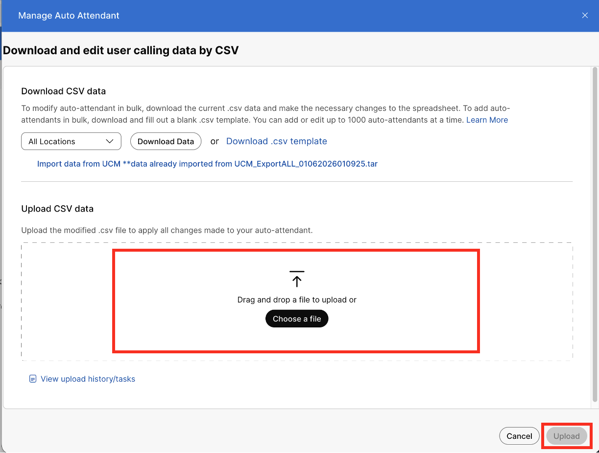

After a successful add, the “Added” field value will increment by the
number of added items in the Tasks status window. Click “Close” to
proceed.

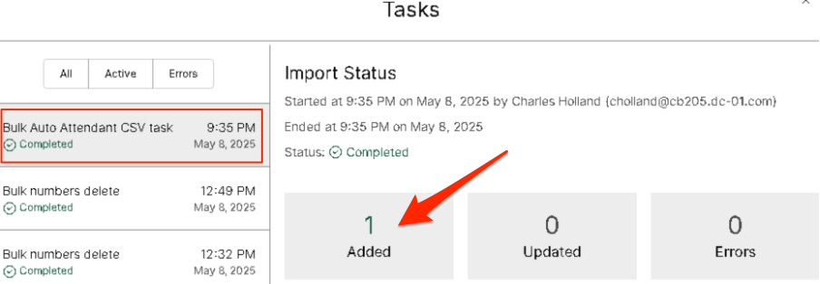

You can go back to the Calling &gt; Features &gt; Auto Attendant &gt;
Manage, to see the recently added Auto Attendant named “SupportDeskIVR”
with extension 6500.

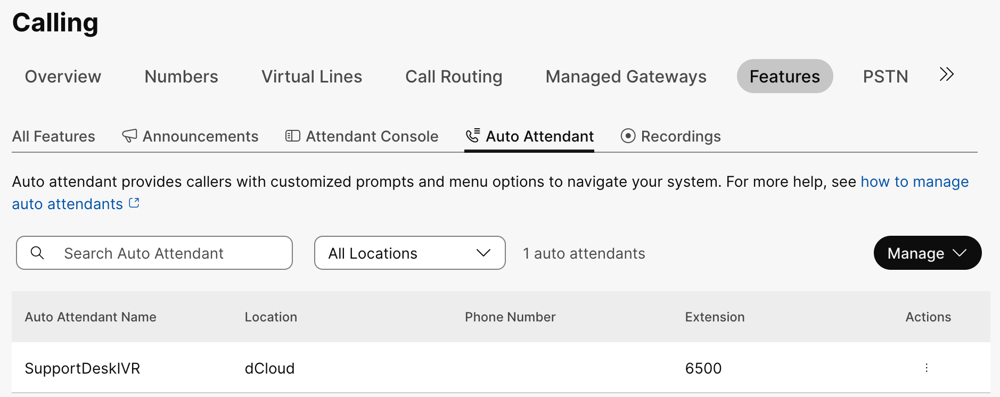

<table style="width:100%;">
<colgroup>
<col style="width: 10%"/>
<col style="width: 89%"/>
</colgroup>
<thead>
<tr>
<th style="text-align: center;"></th>
<th><ul>
<li>
Webex Calling Auto Attendant disconnects a call after 10 seconds
of no key press following the greeting. To adjust this inactivity timer
or set the greeting to repeat, configure the settings in the Auto
Attendant Menu configuration:

<ol type="1">
<li>
Calling &gt; Features &gt; Auto Attendant &gt; Manage &gt; Select
“Menu” in “Business Hours Auto Attendant”
</li>
</ol></li>
</ul>
<blockquote>

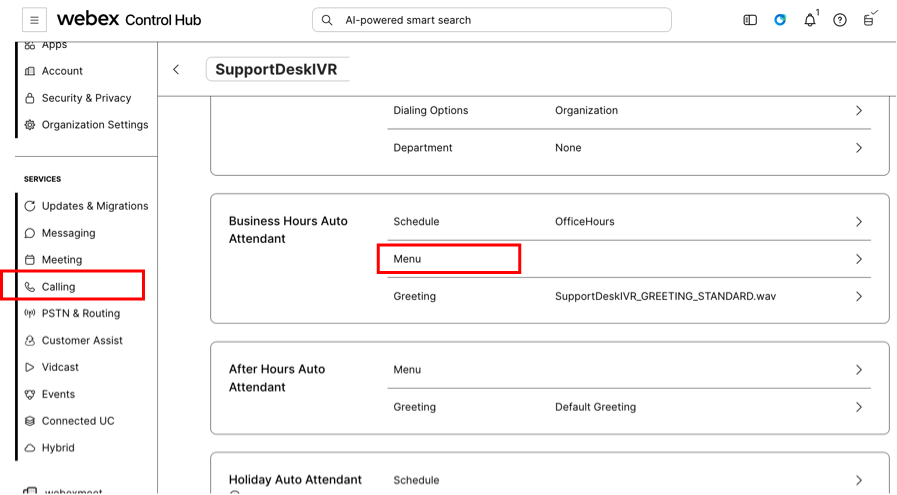

</blockquote>
<ol start="2" type="1">
<li>
Change the setting in “Menu timeout and repeat configuration” as
follow:
</li>
</ol>
<blockquote>

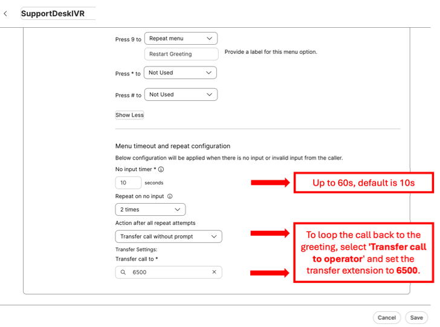

<a href="https://help.webex.com/en-us/article/nsioxoi/Manage-auto-attendants">https://help.webex.com/en-us/article/nsioxoi/Manage-auto-attendants</a>

</blockquote></th>
</tr>
</thead>
<tbody>
</tbody>
</table>

### Using Task Status to Identify Failed Import {#using-task-status-to-identify-failed-import}

In situation when the bulk failed or partial completed, you can
access Task Status directly from Control Hub top banner on the
right-hand side.

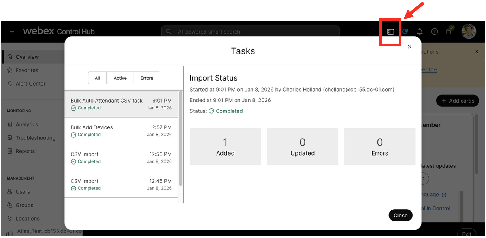

The below is a sample view with a failed/error Auto Attendant bulk
add operation:

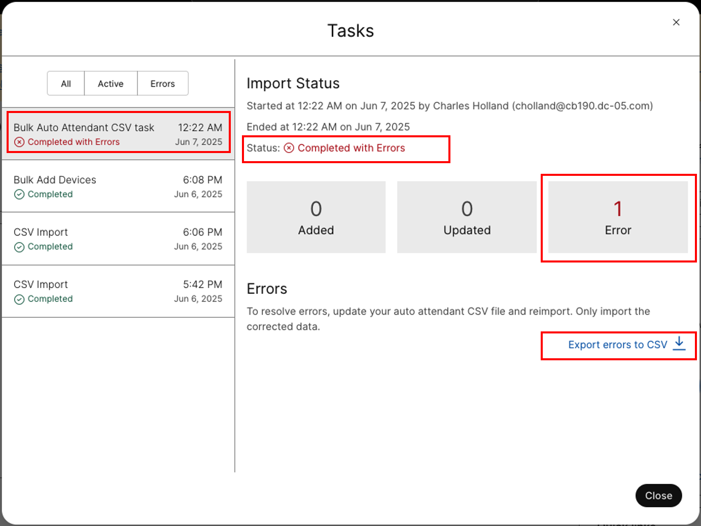

Click on the “Export errors to CSV” to find out details of the error.
Download the “errors.csv” and open it Excel. The below is sample error
for undefined PSTN Webex Number.

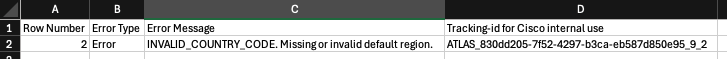

<table style="width:100%;">
<colgroup>
<col style="width: 10%"/>
<col style="width: 89%"/>
</colgroup>
<thead>
<tr>
<th></th>
<th style="text-align: left;">
<strong>Note:</strong>

If the Auto Attendant (AA) is configured to use a PSTN number, ensure
that this number is added to the relevant location(s) first before
proceeding to add the AA with bulk editor.
</th>
</tr>
</thead>
<tbody>
</tbody>
</table>
