# Bulk import Call Queues {#task-7-bulk-import-call-queues-5-minutes}

LABCOL-2883 Task 75 minutes

Some edits need to be done on the bulk csv result to map to the
correct Webex Calling configuration.

Open the “<strong>CallQueueBulk.csv</strong>” file in MS Excel.

Follow the table below to update the values of specific cells in the
csv file.

<table>

<thead>
<tr>
<th>Queue Name</th>
<th>Excel Cell #</th>
<th>Header Name</th>
<th>Original Value</th>
<th>Replacement Value</th>
</tr>
</thead>
<tbody>
<tr>
<td rowspan="5">Q1_WebexCallingSupport</td>
<td>B2</td>
<td>Phone Number</td>
<td>6501</td>
<td>&lt;blank&gt; (delete 6501)</td>
</tr>
<tr>
<td>C2</td>
<td>Extension</td>
<td>Empty</td>
<td>6501</td>
</tr>
<tr>
<td>D2</td>
<td>Location</td>
<td>Error….</td>
<td>dCloud</td>
</tr>
<tr>
<td>I2</td>
<td>Language</td>
<td>Error….</td>
<td>en_us</td>
</tr>
<tr>
<td>J2</td>
<td>Timezone</td>
<td>Error….</td>
<td>America/Los_Angeles</td>
</tr>
<tr>
<td rowspan="5">Q2_WebexContactCenterSupport</td>
<td>B3</td>
<td>Phone Number</td>
<td>6502</td>
<td>&lt;blank&gt; (delete 6502)</td>
</tr>
<tr>
<td>C3</td>
<td>Extension</td>
<td>Empty</td>
<td>6502</td>
</tr>
<tr>
<td>D3</td>
<td>Location</td>
<td>Error….</td>
<td>dCloud</td>
</tr>
<tr>
<td>I3</td>
<td>Language</td>
<td>Error….</td>
<td>en_us</td>
</tr>
<tr>
<td>J3</td>
<td>Timezone</td>
<td>Error….</td>
<td>America/Los_Angeles</td>
</tr>
</tbody>
</table>

<aside class="lab-note" role="note">
<strong>Note:</strong>

Since this is a small lab without a complete dial-plan configuration
(e.g., no PSTN numbers, no inter-site dial prefixes, and no preloaded
greeting audio files), the Migrate Feature from the UCM tool is unable
to map to the correct Webex Calling location or recognize the location
name, language, or greeting file. As a result, the adjustments outlined
above are necessary.
</aside>

Once all the fields updated, close Excel by choosing: File &gt;
Close.

Save the file and click “<strong>Save</strong>” for the prompt
below.

<figure class="lab-figure"><a aria-label="Enlarge Lab guide screenshot 72" class="screenshot-link" href="assets/images/image72.png">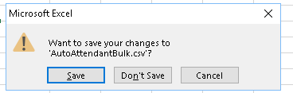</a></figure>

Finally, select “<strong>Yes</strong>” when prompted to save the file
in CSV format.

<figure class="lab-figure"><a aria-label="Enlarge Lab guide screenshot 73" class="screenshot-link" href="assets/images/image73.png">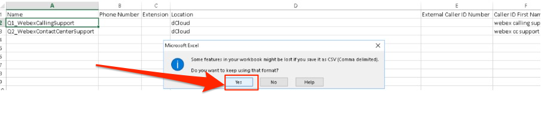</a></figure>

<ol type="1">
<li>
Customer Assist configuration section is under: Services &gt;
Customer Assist
</li>
<li>
It will show 3 licenses (out of 50) already assigned for the
three calling users previously configured.
</li>
<li>
Next is to upload Call Queue <strong>csv</strong> file by
selecting “Queues” tab in the top menu bar
</li>
</ol>

<a aria-label="Enlarge Lab guide screenshot 74" class="screenshot-link" href="assets/images/image74.png">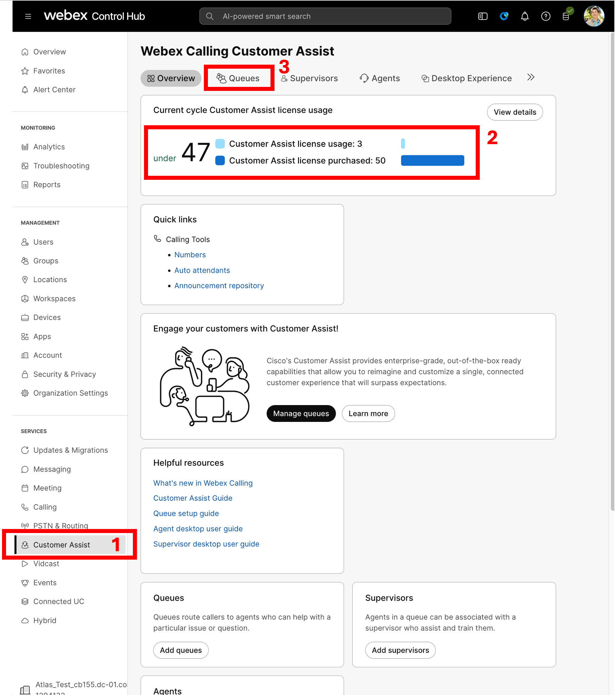</a>

Click on “Bulk Manage”.

<figure class="lab-figure"><a aria-label="Enlarge Lab guide screenshot 75" class="screenshot-link" href="assets/images/image75.png">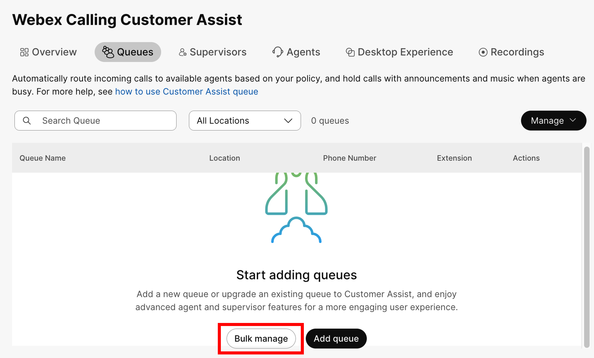</a></figure>

Upload the file that we just edited
“<strong>CallQueueBulk.csv</strong>” by drag-and-drop or click on
“Choose a file”.

<figure class="lab-figure"><a aria-label="Enlarge Lab guide screenshot 76" class="screenshot-link" href="assets/images/image76.png">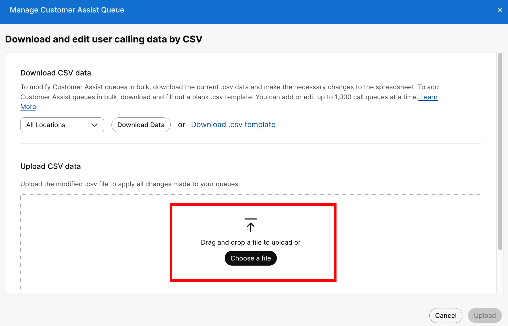</a></figure>

Click “Upload” to start the bulk add for Call Queues.

<figure class="lab-figure"><a aria-label="Enlarge Lab guide screenshot 77" class="screenshot-link" href="assets/images/image77.png">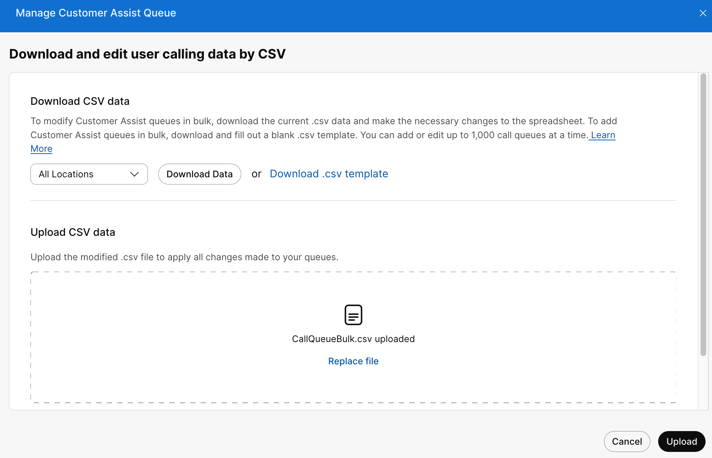</a></figure>

You should see the status 2 Queues were added.

<figure class="lab-figure"><a aria-label="Enlarge Lab guide screenshot 78" class="screenshot-link" href="assets/images/image78.png">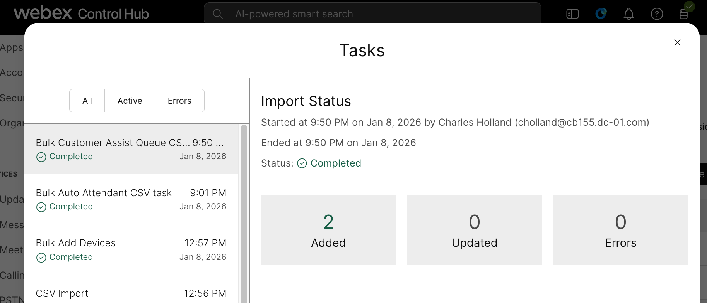</a></figure>

Close the window to go back to Queues, showing 6501 and 6502 were
added.

<figure class="lab-figure"></figure>

You can refer to this table for the agents and supervisor
assignments.

<table>

<thead>
<tr>
<th>User</th>
<th>User Extension</th>
<th>Queue</th>
<th>Queue Extension</th>
<th>Role</th>
</tr>
</thead>
<tbody>
<tr>
<td>Anita Perez</td>
<td>6017</td>
<td>Q1_WebexCallingSupport</td>
<td>6501</td>
<td>Agent</td>
</tr>
<tr>
<td>Kellie Melby</td>
<td>6050</td>
<td>Q1_WebexCallingSupport</td>
<td>6501</td>
<td>Agent</td>
</tr>
<tr>
<td>Taylor Bard</td>
<td>6026</td>
<td>Q1_WebexCallingSupport 
Q2_WebexContactCenterSupport</td>
<td>6501 
6502</td>
<td>Supervisor</td>
</tr>
</tbody>
</table>

<strong>Option 1 to verify agents’ assignments:</strong>

Go to “<strong>Q1_WebexCallingSupport</strong>” queue, click “Agents”
in the overview section.

<figure class="lab-figure"><a aria-label="Enlarge Lab guide screenshot 80" class="screenshot-link" href="assets/images/image80.png">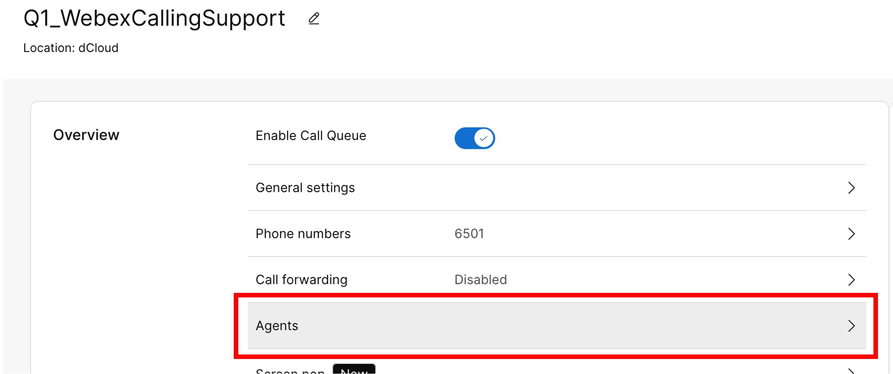</a></figure>

You would see “Anita Perez” and “Kellie Melby” are already assigned
as agents, this configuration was imported from the Unified
Communications Manager Hunt Pilot Queue data export.

<figure class="lab-figure"><a aria-label="Enlarge Lab guide screenshot 81" class="screenshot-link" href="assets/images/image81.png">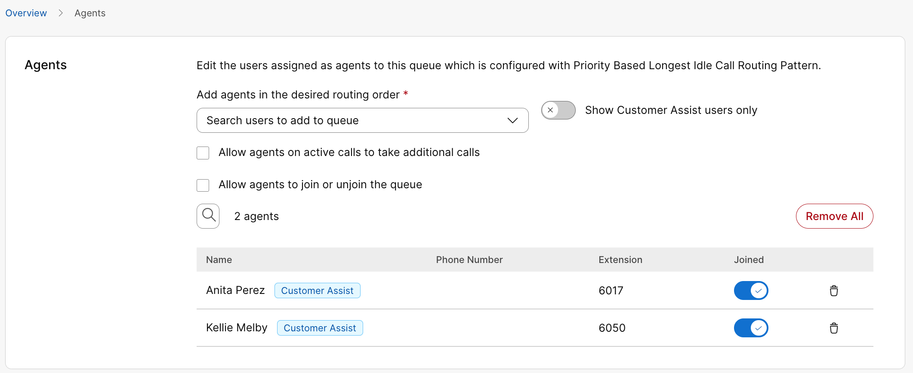</a></figure>

Repeat the same steps to view
“<strong>Q2_WebexContactCenterSupport</strong>” Agents configuration you
would see “Taylor Bard” as an assigned Agent.

<figure class="lab-figure"><a aria-label="Enlarge Lab guide screenshot 82" class="screenshot-link" href="assets/images/image82.png">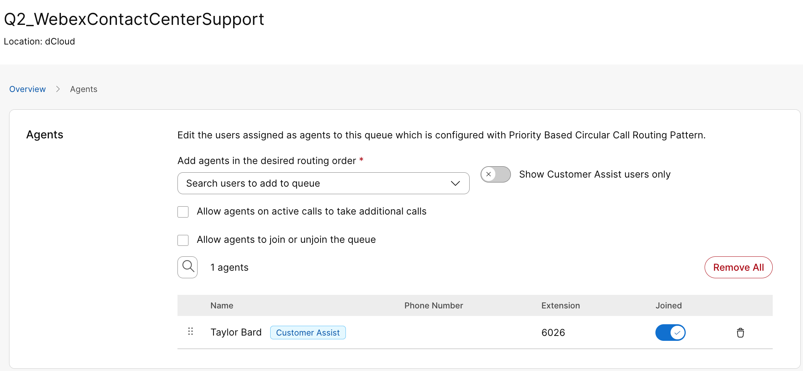</a></figure>

<strong>Option 2 to verify agents’ assignments:</strong>

From Customer Assist dashboard, click “Agents” to see all agents
defined in all Call Queues. You can click on “&gt;” to the left of the
agent name to see more detail.

<figure class="lab-figure"><a aria-label="Enlarge Lab guide screenshot 83" class="screenshot-link" href="assets/images/image83.png">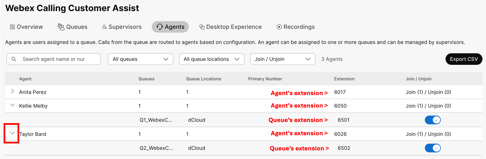</a></figure>
## Using Task Status to Identify Failed Import {#using-task-status-to-identify-failed-import-1}

You can use “<strong>Task Status</strong>” as shown in Task 6 to
check status of past bulk add for Auto Attendant and Call Queues.

<figure class="lab-figure"><a aria-label="Enlarge Lab guide screenshot 84" class="screenshot-link" href="assets/images/image84.png">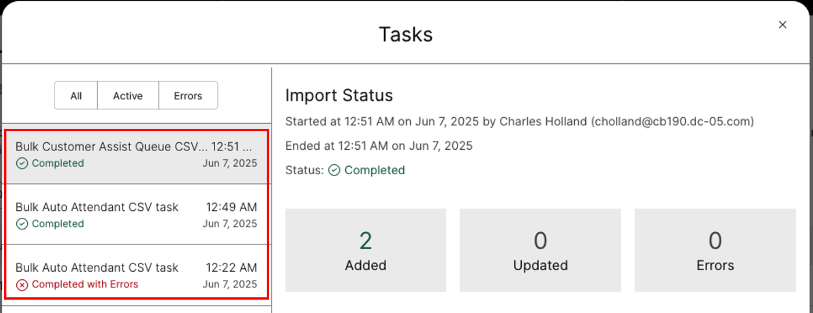</a></figure>
