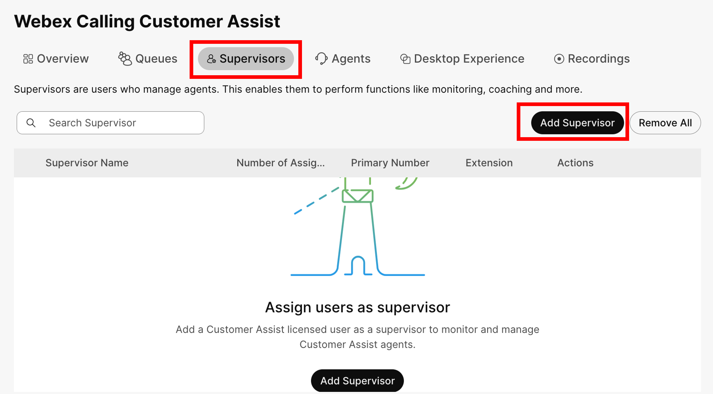
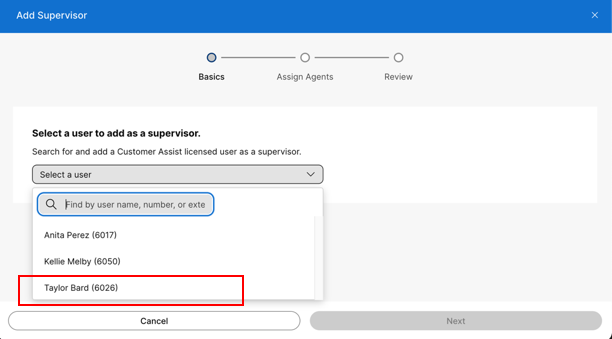
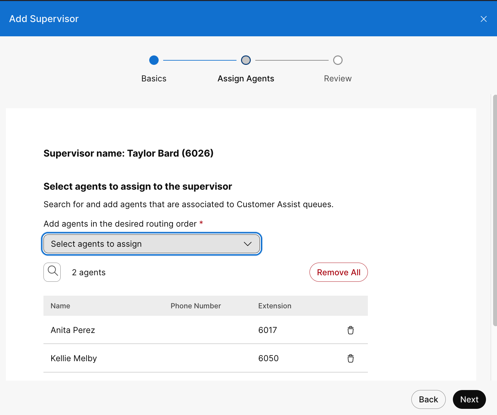
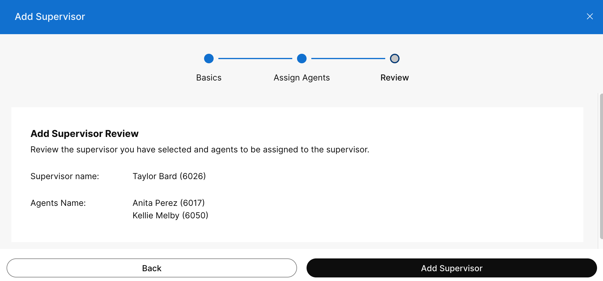
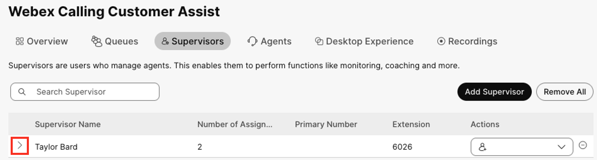
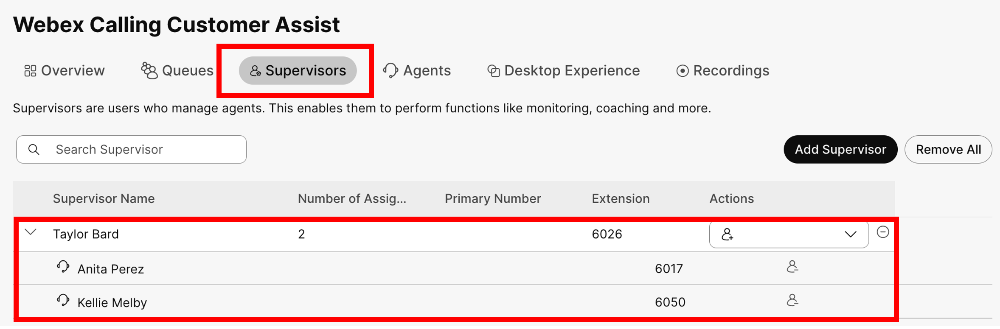

# Add Supervisor for Customer Assist {#task-8-add-supervisor-for-customer-assist-5-minutes}

LABCOL-2883 Task 85 minutes

Go back to Customer Assist main dashboard, by selecting “Customer
Assist” in the Services section. Click on “Supervisors” tab and add
Taylor Bard as supervisor.

<figure class="lab-figure"></figure>

Click on “Select a user” and choose Taylor Bard. And then click
“Next”.

<figure class="lab-figure"></figure>

In the next screen select “Anita Perez” and “Kellie Melby” as Agents
for Taylor to supervise. Click “Next” to proceed.

<figure class="lab-figure"></figure>

Click “Add Supervisor” in the next screen.

<figure class="lab-figure"></figure>

Now you can see “Taylor Bard” listed as Supervisor.

<figure class="lab-figure"></figure>

Press the “&gt;” sign to show list of Agents that Taylor
supervised.

<figure class="lab-figure"></figure>
