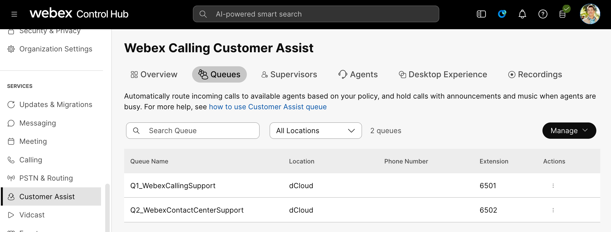
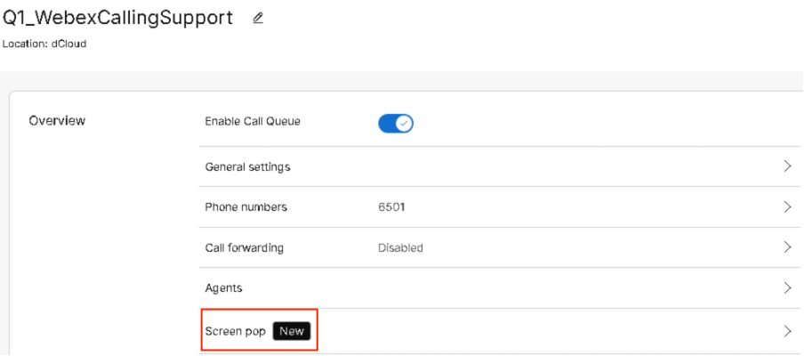
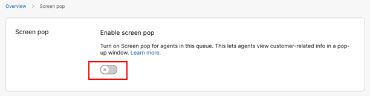
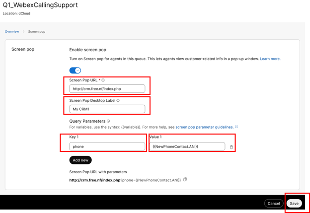

# Task 9: Advance Call Queue Configuration [5 minutes] {#task-9-advance-call-queue-configuration-5-minutes}

### Step 1: Screen Pop {#step-1-screen-pop}

You can configure screen pop settings to display the customer
information screen on the Agent's desktop when an agent answers an
incoming call.

<table style="width:97%;">
<colgroup>
<col style="width: 35%"/>
<col style="width: 18%"/>
<col style="width: 14%"/>
<col style="width: 30%"/>
</colgroup>
<thead>
<tr>
<th style="text-align: left;">
Screen Pop URL

[required]
</th>
<th>Screen Pop Desktop Label [optional]</th>
<th style="text-align: left;">
Key 1

[required]
</th>
<th style="text-align: left;">
Value 1

[required]
</th>
</tr>
</thead>
<tbody>
<tr>
<td style="text-align: left;">http://crm.free.nf/index.php</td>
<td>My CRM1</td>
<td style="text-align: left;">phone</td>
<td style="text-align: left;">{{NewPhoneContact.ANI}}</td>
</tr>
<tr>
<td style="text-align: left;">
http://crm.iceiy.com/index.php

[backup]
</td>
<td>My CRM2</td>
<td style="text-align: left;">phone</td>
<td style="text-align: left;">{{NewPhoneContact.ANI}}</td>
</tr>
</tbody>
</table>

<table style="width:100%;">
<colgroup>
<col style="width: 11%"/>
<col style="width: 88%"/>
</colgroup>
<thead>
<tr>
<th></th>
<th style="text-align: left;">
<strong>Note:</strong>

Only one Screen Pop URL can be configured per call queue, but each
call queue can have their own Screen Pop URL providing flexibility in
different Screen Pop application(s).

List of Values/Variables that can be used are listed here:

<a href="https://help.webex.com/en-us/article/72sb3r/Webex-Calling-Customer-Assist#task-template_b70d32ce-9ddd-447a-b1f2-8ae99f961b69">https://help.webex.com/en-us/article/72sb3r/Webex-Calling-Customer-Assist#task-template_b70d32ce-9ddd-447a-b1f2-8ae99f961b69</a>

ANI = phone number of the caller that initiate the call.
</th>
</tr>
</thead>
<tbody>
</tbody>
</table>

Back to Customer Assist main dashboard, by selecting “Customer
Assist” in the Services section. Click on “Queues” tab.

Follow the steps below to complete Screen Pop-up configuration for
each Call Queue:

<ol type="1">
<li>
Click on the queue to be configured, click on
“Q1_WebexCallingSupport”
</li>
<li>
Click on “Screen pop”
</li>
</ol>

<blockquote>

</blockquote>

<ol start="3" type="1">
<li>
Toggle the button icon to enable Screen pop
configuration
</li>
</ol>

<blockquote>

</blockquote>

<ol start="4" type="1">
<li>
Enter the configuration settings as below –
</li>
</ol>

<ul>
<li>
Screen Pop URL: <a href="http://crm.free.nf/index.php">http://crm.free.nf/index.php</a>
</li>
<li>
Screen Pop Desktop Label: My CRM1
</li>
<li>
Click “Add New” under Query Parameter
</li>
<li>
Key 1: phone
</li>
<li>
Value1: {{NewPhoneContact.ANI}}
</li>
</ul>

<blockquote>

Click “Save” to save and activate this Screen Pop setting.

By configuring screen pops, agents can quickly identify callers and
access their details, enabling more effective and personalized
service.

Repeat the above steps (2-4) for “Q2_WebexContactCenterSupport”
queue.

</blockquote>

<strong>This completes the main portion of this lab: export, prep and
import of Auto Attendant and Queue configuration from Unified
Communications Manager and Unity Connection.</strong>

### Step 2: Other Advance Features {#step-2-other-advance-features}

Due to the time constraints of this lab, many advanced features
offered under Customer Assist will not be covered. However, a brief
description and additional links for further details and configuration
steps are provided, allowing you to explore and implement them after
completing

<table style="width:93%;">
<colgroup>
<col style="width: 16%"/>
<col style="width: 20%"/>
<col style="width: 45%"/>
<col style="width: 11%"/>
</colgroup>
<thead>
<tr>
<th style="text-align: left;">Features</th>
<th>Section</th>
<th>Brief Description</th>
<th style="text-align: center;">URL</th>
</tr>
</thead>
<tbody>
<tr>
<td>Call Back Option</td>
<td>Overview</td>
<td>The call back option allows callers to receive a call-back to the
phone number provided when their original position in the queue reaches.
The phone number is verified against a location’s outgoing calls
policy.</td>
<td rowspan="5" style="text-align: center;"><a href="https://help.webex.com/en-us/article/72sb3r/Webex-Calling-Customer-Assist">Link</a></td>
</tr>
<tr>
<td>Wrap-up reasons</td>
<td>Overview</td>
<td>The wrap reason is a predefined label which helps agents to
summarize the purpose or outcome of their customer’s call. This record
helps the supervisors or managers to track the customer service
performance and monitor and improve agent performance.</td>
</tr>
<tr>
<td>Night Service</td>
<td>Queue Policies</td>
<td>Configure the queue to route calls differently during the hours when
the queue is not in service.</td>
</tr>
<tr>
<td>Estimated wait message for Queued Calls</td>
<td>Announcements</td>
<td>Notify the caller with either their estimated wait time in the
queue</td>
</tr>
<tr>
<td>Announce queue position</td>
<td>Announcements</td>
<td>Notify the caller with either their estimated position in the
queue</td>
</tr>
</tbody>
</table>
