# Validation step {#task-10-validation-step-10-minutes}

LABCOL-2883 Task 1010 minutes

We can now validate the Auto Attendant and Call Queues that we just
imported to Webex Calling Customer Assist.

<ul>
<li>
To perform the validation, login as Charles Holland, Anita Perez
and Taylor Bard with Webex app. Follow the table below on which
workstation to login for each user.
</li>
<li>
User ID and password can be found in <a href="03-task-1-accessing-your-lab.html#login-to-the-webex-clients">Task 1: Step 2 – Login Credentials for Control
Hub</a>.
</li>
</ul>

<table>

<thead>
<tr>
<th>User</th>
<th>Queue Name</th>
<th>Role</th>
<th>Workstation to use</th>
</tr>
</thead>
<tbody>
<tr>
<td>Charles Holland</td>
<td>n/a</td>
<td>Caller / Customer</td>
<td>Walk-In-Lab PC</td>
</tr>
<tr>
<td>Anita Perez</td>
<td>Q1_WebexCallingSupport</td>
<td>Agent</td>
<td>Workstation 2</td>
</tr>
<tr>
<td>Taylor Bard</td>
<td>Q1_WebexCallingSupport 
Q2_WebexContactCenterSupport</td>
<td>Supervisor</td>
<td>Workstation 1</td>
</tr>
</tbody>
</table>

## Step 1: Login to Webex app as Charles Holland {#step-1-login-to-webex-app-as-charles-holland}

Launch the Webex app from the main desktop view on the
<strong>Walk-In-Lab PC</strong> by double-clicking the Webex app icon.
Alternatively, you can use your own PC, tablet, or smartphone.
<strong>Avoid using Charles Holland's Workstation1</strong>, as the
virtual PC in Expo lacks microphone input and may interfere with DTMF
digit recognition during greeting and menu selection.

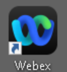

Click the “Sign in” and use the user-id for the user as below:

<strong>Control Hub and Webex app userid</strong>: <a href="mailto:cholland@cbxxx.dc-yy.com"><mark>cholland@cbxxx.dc-yy.com</mark></a>
(userid@<em>domain_name</em>)

<strong>Control Hub password:</strong> <mark>[password from your assigned session]</mark>
(dCloud + <em>last four digits of session ID</em> + !)

Refer to the “<strong>WEBEX_PASSWORD.txt</strong>” file (Task 1 –
Step 3, page 13) for the userid and password applicable for you
session.

<figure class="lab-figure"><a aria-label="Enlarge Lab guide screenshot 95" class="screenshot-link" href="assets/images/image95.png">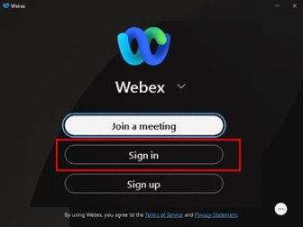</a></figure>

Click the <strong>two</strong> <strong>checkboxes</strong> and select
“<strong>Allow Access</strong>” to continue if you encountered this
pop-up for Webex app – usually happened during first launch.

<figure class="lab-figure"><a aria-label="Enlarge Lab guide screenshot 96" class="screenshot-link" href="assets/images/image96.png">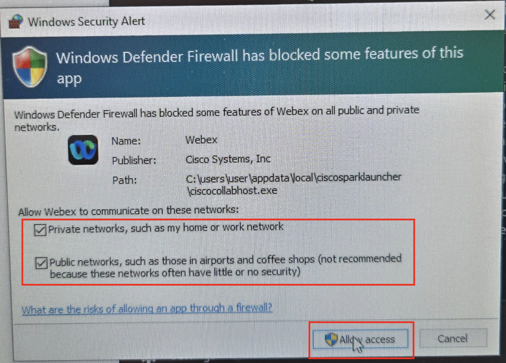</a></figure>

Click “Ok” to acknowledge Emergency Calling Notification warning.
Refer to the Appendix section to learn more about Emergency Calling for
Webex Calling [out of scope for this lab].

<figure class="lab-figure"><a aria-label="Enlarge Lab guide screenshot 97" class="screenshot-link" href="assets/images/image97.png">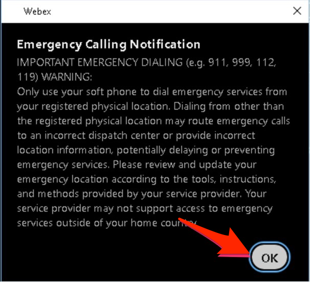</a></figure>

Charles Holland will simulate caller into our Support Desk queue and
is not configured for any Webex Calling Customer Assist features and
thus will not have Customer Assist option available under Webex app.

<figure class="lab-figure"><a aria-label="Enlarge Lab guide screenshot 98" class="screenshot-link" href="assets/images/image98.png">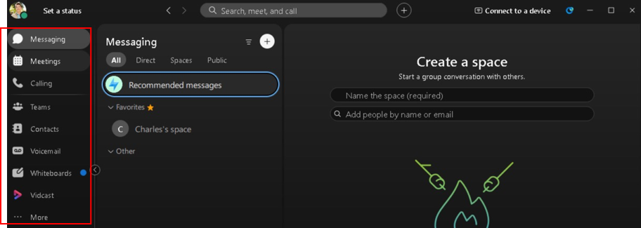</a></figure>

## Step 2: Login to Webex app as Anita Perez {#step-2-login-to-webex-app-as-anita-perez}

Logged in to Webex app in Workstation 2 as Anita Perez from Expo web
browser portal.

Once logged in you would notice Anita Perez has additional option
available under Webex app. Click “Customer Assist” on the left column of
Webex app, which will show the Queue assignment and status Available in
the left bottom.

<figure class="lab-figure"><a aria-label="Enlarge Lab guide screenshot 99" class="screenshot-link" href="assets/images/image99.png">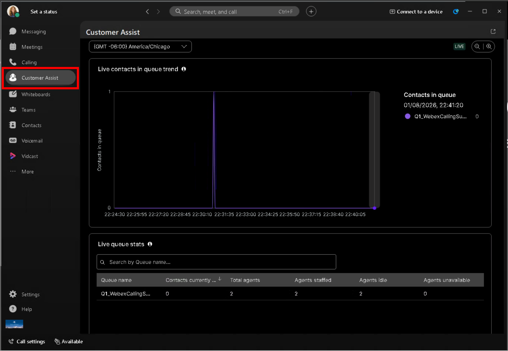</a></figure>
## Step 3: Call-in to Auto Attendant x6500 {#step-3-call-in-to-auto-attendant-x6500}

Use Charle Holland Webex app to make a call to Auto Attendant (x6500)
for Support Desk menu option. Verify that Charles Holland is logged in
to Webex app from <strong>Walk-in Lab PC</strong>.

Click on “Calling” button and type-in 6500 either 1] on the “Search
or Dial” or 2] by pressing the dialer pad.

<figure class="lab-figure"><a aria-label="Enlarge Lab guide screenshot 103" class="screenshot-link" href="assets/images/image103.png">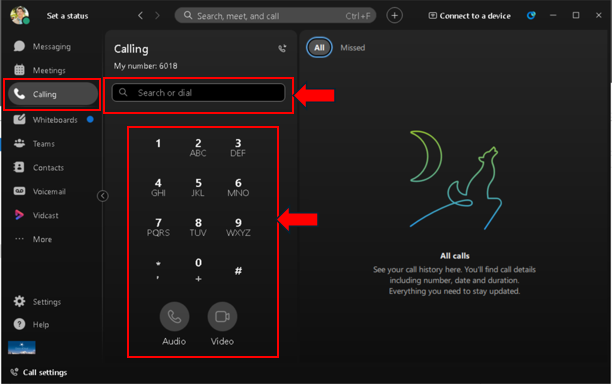</a></figure>

Press the “handset” icon to initiate the call.

<table>

<thead>
<tr>
<th>Typing 6500 in the “Search or dial”</th>
<th>Pressing 6500 on the Dialer pad</th>
</tr>
</thead>
<tbody>
<tr>
<td><a aria-label="Enlarge Lab guide screenshot 104" class="screenshot-link" href="assets/images/image104.png">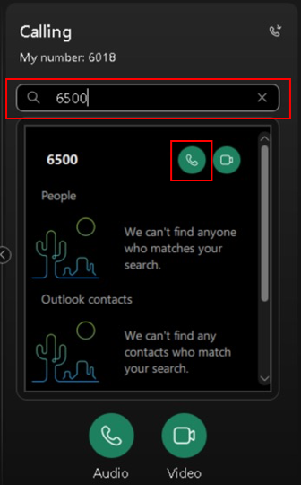</a></td>
<td><a aria-label="Enlarge Lab guide screenshot 105" class="screenshot-link" href="assets/images/image105.png">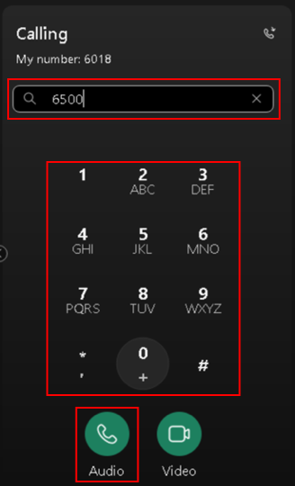</a></td>
</tr>
</tbody>
</table>

A call window will pop-up and you will hear the greeting audio file
that was uploaded earlier. Click on the dialer pad icon 
and press “1” to choose Q1_WebexCallingSupport.

<figure class="lab-figure"><a aria-label="Enlarge Lab guide screenshot 107" class="screenshot-link" href="assets/images/image107.png">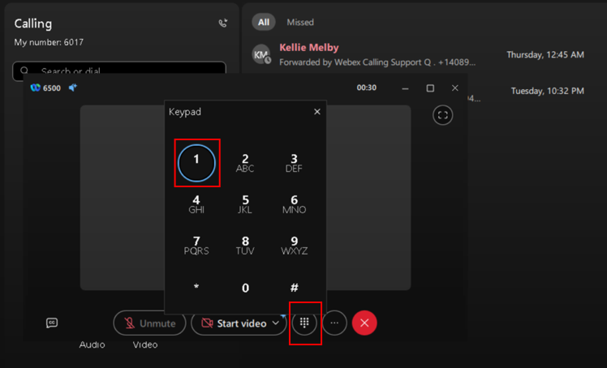</a></figure>

<table>

<thead>
<tr>
<th></th>
<th>
<strong>Note:</strong>

<strong>OPTIONAL</strong> – To test call-ins from US PSTN numbers,
you can assign the dCloud main location PSTN number to the Auto
Attendant while keeping the extension set to 6500. To locate the main
number for the location, go to the "Calling" section and select
"Numbers".

<figure class="lab-figure"><a aria-label="Enlarge Lab guide screenshot 108" class="screenshot-link" href="assets/images/image108.png">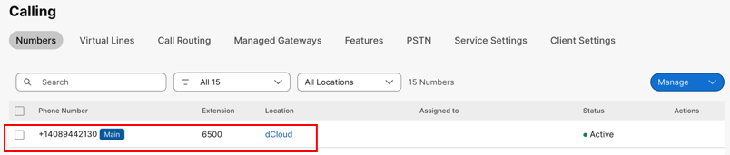</a></figure>
<figure class="lab-figure"><a aria-label="Enlarge Lab guide screenshot 109" class="screenshot-link" href="assets/images/image109.png">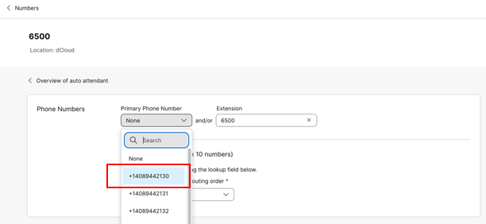</a></figure></th>
</tr>
</thead>
<tbody>
<tr>
<td></td>
<td></td>
</tr>
</tbody>
</table>

## Step 4: Agent Experience for Customer Assist {#step-4-agent-experience-for-customer-assist}

<strong>Live Queue Status:</strong>

Leave the call rings and let’s quickly review the available queue
status that both Agents and Supervisors can monitor in “Customer Assist”
tab. It provides live Queue status for number of calls in queue, number
of agents available, list of queues.

<figure class="lab-figure"><a aria-label="Enlarge Lab guide screenshot 110" class="screenshot-link" href="assets/images/image110.png">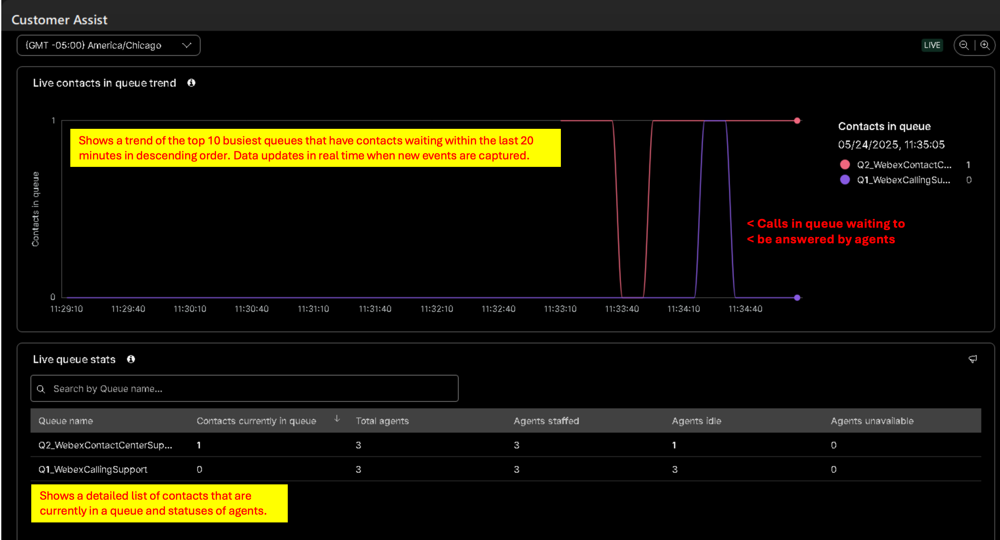</a></figure>

<strong>Answering the Call:</strong>

Goto Anita Perez Workstation and you could see the call alerting
window. Answer the call by selecting “Answer”

<figure class="lab-figure"><a aria-label="Enlarge Lab guide screenshot 111" class="screenshot-link" href="assets/images/image111.png">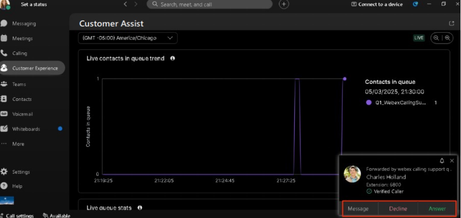</a></figure>

As this lab is running on virtual machine, you will get “No
microphone found” warning when the call is connected to Webex app. Just
ignore it and click “Ok” to continue interaction on Webex app.

<figure class="lab-figure"><a aria-label="Enlarge Lab guide screenshot 112" class="screenshot-link" href="assets/images/image112.png">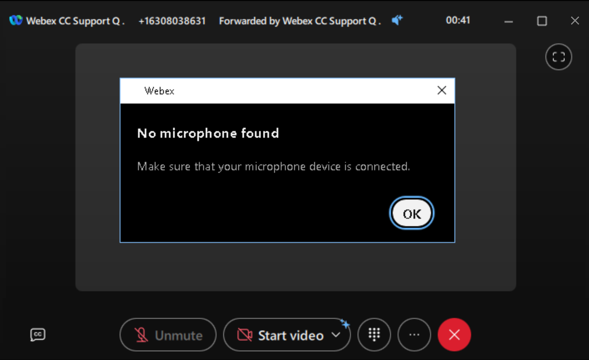</a></figure>

<strong>Screen Pop:</strong>

As soon as the call is answered, screen pop in the form of a new
browser window will display with the caller details.

<figure class="lab-figure"><a aria-label="Enlarge Lab guide screenshot 113" class="screenshot-link" href="assets/images/image113.png">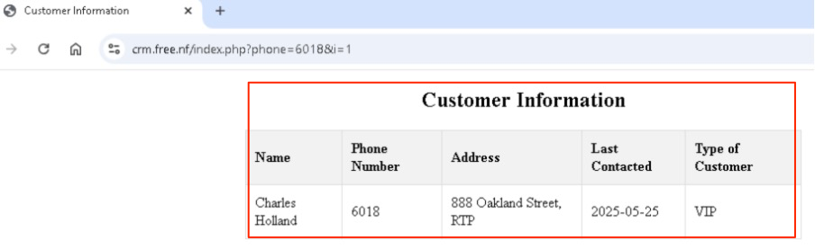</a></figure>

## Step 5: Supervisor Experience for Customer Assist {#step-5-supervisor-experience-for-customer-assist}

If you have time, you can login as Supervisor Taylor Bard from
Workstation 1 and login to Webex app to experience the Supervisor
functions and monitoring capabilities.

<strong>Agents Monitoring and Agents Status change:</strong>

<figure class="lab-figure"><a aria-label="Enlarge Lab guide screenshot 114" class="screenshot-link" href="assets/images/image114.png">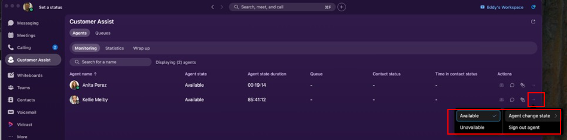</a></figure>

In this view, Supervisor can perform the following actions:

<table>

<thead>
<tr>
<th></th>
<th>Monitor: listen in to a conversation between an agent and a customer
in real time.</th>
</tr>
</thead>
<tbody>
<tr>
<td></td>
<td>Chat: chat with an agent, you can send and receive messages directly
with them.</td>
</tr>
<tr>
<td></td>
<td>Manage: join or unjoin agents from a queue. When agents join queues
and are available, they start to receive calls.</td>
</tr>
<tr>
<td></td>
<td>Change agent status: Choose whether your agents are available or
unavailable to take calls in their queues</td>
</tr>
</tbody>
</table>

See appendix for additional resources for “Get started with Webex
Calling Customer Assist for Supervisors”.

<strong>Agents Historical Statistics:</strong>

<figure class="lab-figure"><a aria-label="Enlarge Lab guide screenshot 119" class="screenshot-link" href="assets/images/image119.png">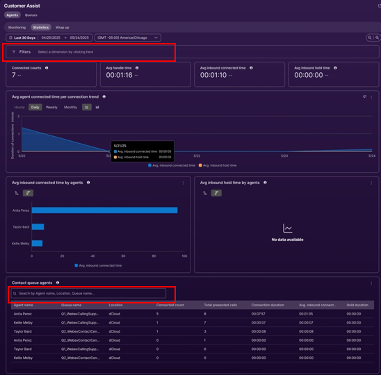</a></figure>

This view can be filtered by: Agent name, Queue name, or Location
name.

<strong>Queues Realtime:</strong>

This is a similar view to Agent Experience for Customer Assist in
Step 4 above.

<strong> 
</strong>

<strong>Queues Historical Statistics</strong>

<figure class="lab-figure"><a aria-label="Enlarge Lab guide screenshot 120" class="screenshot-link" href="assets/images/image120.png">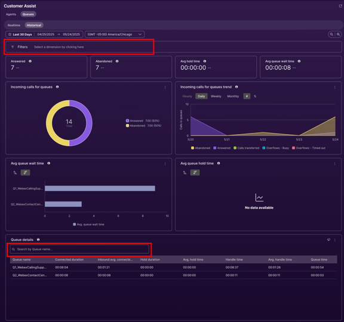</a></figure>

This view can be filtered by: Queue name.

<strong>Congratulations, you completed the main portion of this
lab.</strong>

