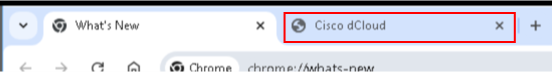
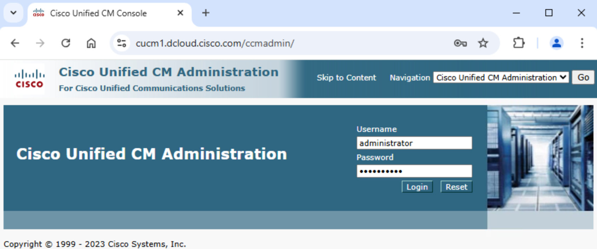
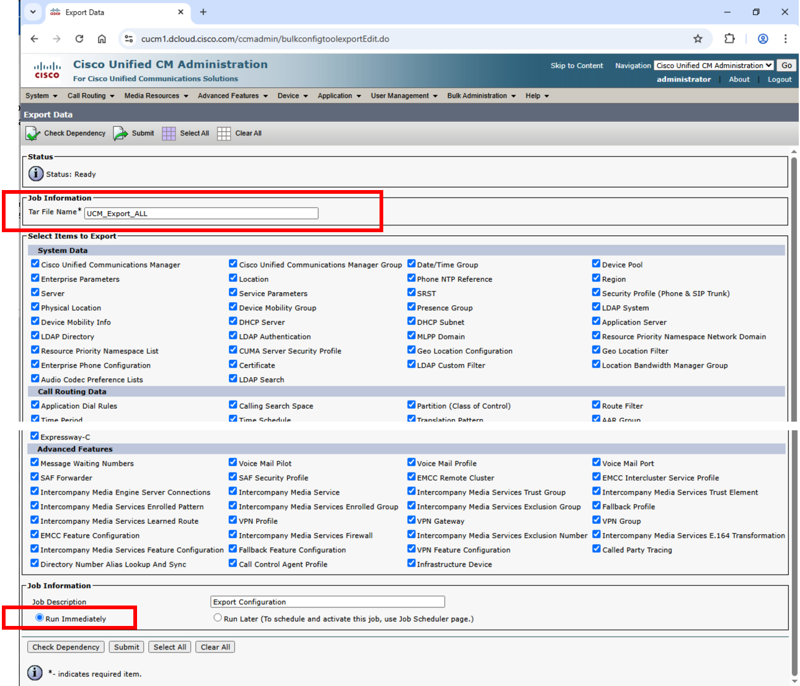
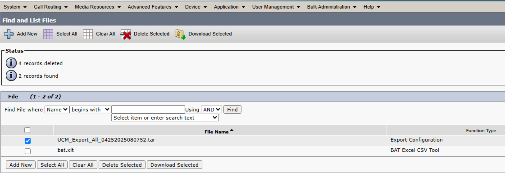
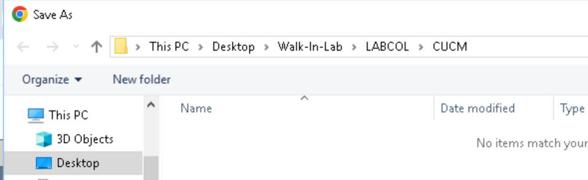
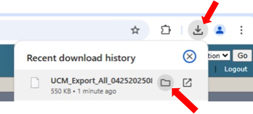
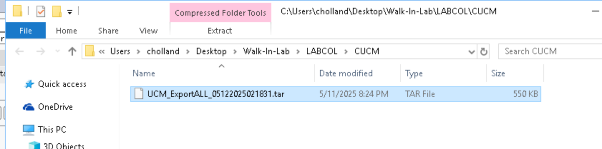

# Create Unified Communications Manager bulk config export tar file {#task-2-create-unified-communications-manager-bulk-config-export-tar-file-5-minutes}

LABCOL-2883 Task 25 minutes

## Step 1: Login to Unified Communications Manager admin portal {#step-1-login-to-unified-communications-manager-admin-portal}
<ol type="1">
<li>
Remote desktop to Workstation 1 as shown in <strong>Task
1</strong> – Accessing your Lab.
</li>
<li>
Launch Chrome browser &gt; and find the tab named “Cisco dCloud”.
If you do not see this tab, just open a new tab, the home page of new
tab in this lab is set to Cisco dCloud.
</li>
</ol>

You can also close the “What’s New” tab.

<figure class="lab-figure"></figure>

<ol start="3" type="1">
<li>
Click on “Collaboration Admin Links” &gt; jot down the userid and
password shown in “Cisco Unified Communication Manager”
</li>
</ol>

[Screenshot with example access credentials omitted. Use your assigned lab session details.]

<ol start="4" type="1">
<li>
Click on “Cisco Unified Communication Manager”
</li>
<li>
Type in the userid and password from step #2 above, and then
click “Login”
</li>
</ol>
<figure class="lab-figure"></figure>
## Step 2: Create Export TAR file {#step-2-create-export-tar-file}
<ol type="1">
<li>
Navigate to “Bulk Administration” &gt; “Import/Export” &gt; and
then click on “Export”
</li>
<li>
Click on “Select All” 
</li>
<li>
Type in “UCM_ExportALL” in the “Tar File Name” field
</li>
<li>
Click on “Run Immediately” and then click on “Submit”
</li>
</ol>
<figure class="lab-figure"></figure>
## Step 3: Download Unified Communications Manager Export TAR file {#step-3-download-unified-communications-manager-export-tar-file}
<ol type="1">
<li>
Navigate to “Bulk Administration” &gt; “Upload/Download Files”
&gt; click on “Find”
</li>
<li>
It might take up to 1-2 minutes for the tar file to be created
and shown. Occasionally re-click the “Find” button till the
“UCM_Export_All_xxxxxx.tar” file appear.
</li>
<li>
Click the check box to the left of
“UCM_Export_All_xxxxxx.tar”
</li>
</ol>
<figure class="lab-figure"></figure>
<ol start="4" type="1">
<li>
Click “Download Selected”.
</li>
<li>
This lab’s Chrome browser has been setup to use
</li>
</ol>

“C:\Users\cholland\Desktop\Walk-In-Lab\LABCOL\CUCM” as the default
download location.

<figure class="lab-figure"></figure>

<ol start="6" type="1">
<li>
You can navigate to the download folder directly by left click on
the download icon on Chrome browser and left click on the folder icon.
Make note of the location of this tar file. We will be needing it in
Task 4.
</li>
</ol>
<figure class="lab-figure"></figure>
<figure class="lab-figure"></figure>
