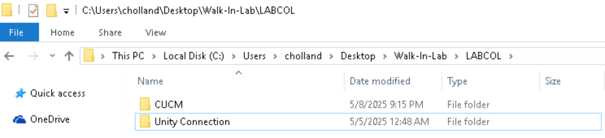
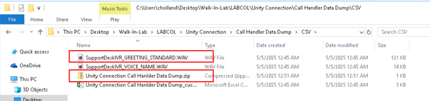

# Locate the prepared Unity Connection files {#task-3-create-unity-connection-call-handler-data-dump-3-minutes}

LABCOL-2883 Task 33 minutes

<aside class="lab-note" role="note">
<strong>Note:</strong>

To save time for this lab, Unity Connection Call Handler greeting wav
and csv files already created and available for use in Workstation 1
Desktop Folder.
</aside>
<ol type="1">
<li>
On Workstation 1’s Desktop view, search for “Walk-In-Lab”
folder.
</li>
<li>
Double clicks on “LABCOL”, folder and then double click again on
“Unity Connection” folder.
</li>
</ol>

<figure class="lab-figure"></figure>

<ol start="3" type="1">
<li>
In “Unity Connection &gt; Call Handler Data Dump &gt; CSV”
folder, you would find two files below needed for this lab:
</li>
</ol>
<ul>
<li>
Greeting wav file:
<strong>SupportDeskIVR_GREETING_STANDARD.WAV</strong>
</li>
<li>
Call Handler Data Dump output: <strong>Unity Connection Call
Handler Data Dump.zip</strong>
</li>
</ul>

<figure class="lab-figure"></figure>

<aside class="lab-note" role="note">
<strong>Note:</strong>

<ol type="1">
<li>
<strong>Control Hub Updates and Migration Tools</strong> only
support tar and zip files.
</li>
</ol>

Thus, Unity Connection Call Handler results (originally in CSV
format) must be compressed into a zip file before being uploaded to
Control Hub.

<ul>
<li>
We already created this zip at the start of the lab – file name
is: Unity Connection Call Handler Data Dump.zip
</li>
<li>
Unity Connection Call Handler Data Dump output is: “Unity
Connection Call Hanlder Data
Dump_cuc1.dcloud.cisco.com_CSV_Output_250505_12_45_56.CSV”
</li>
</ul>
<ol start="2" type="1">
<li>
This lab uses the prepared data dump and greeting files. Installing and running the Call Handler Data Dump tool is outside the scope of this lab.
</li>
</ol></aside>
